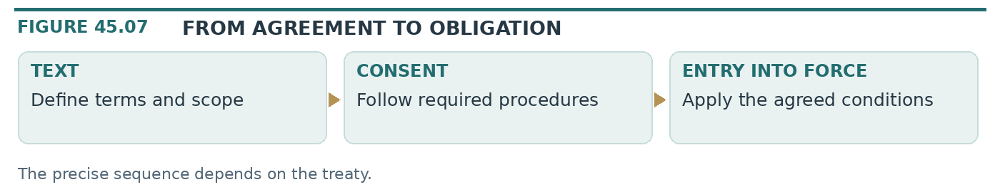

Договорът е международно споразумение, уреждано от международното право; той не е решаващ. Виенската конвенция за правото на договорите от 1969 г. се отнася до писмени договори между държавите и кодира важни правила относно съгласието, тълкуването и изпълнението. Меморандумът може да бъде обвързващ или необвързващ в зависимост от неговите условия и обстоятелства. Общата декларация може да изразява политиката, а не правните задължения. Нито официално заглавие, нито церемониален подпис решава всеки правен въпрос.

Подписването, ратифицирането и влизането в сила са отделни стъпки. Някои споразумения обвързват страните при подписването; други изискват ратификация или допълнителни условия. Вътрешното одобрение и международното съгласие имат различни функции. От дадена държава може да се изисква да завърши конституционните процедури преди ратификацията. Клаузата за влизане в сила след това определя кога договорът става оперативен. Резервациите, разпоредбите за оттегляне и клаузите за уреждане на спорове могат да засегнат обхвата на ангажиментите.

Когато четеш дипломатическо заглавие, намери истинския текст, ако е възможно. Идентифициране на страните, правния статут, условията, териториалния обхват, продължителността и конкретните глаголи, изразяващи задължения. Споразумението обещава ли консултации, сътрудничество или взаимна помощ? Влиза ли в сила веднага? Обкръжаващата пресконференция е важно доказателство за политически намерения, но не замества самия документ. \[<a href="/045-diplomacy-alliances-and-balance-of-power/sources/#source-10" class="cite">10</a>\]\[<a href="/045-diplomacy-alliances-and-balance-of-power/sources/#source-46" class="cite">46</a>\]

<figure class="figure" id="figure-45-7">

<figcaption>Фигура 45.7. Точната последователност зависи от договора. <a class="figure-anchor" href="#figure-45-7" aria-label="Link to this figure">#</a></figcaption>
</figure>
