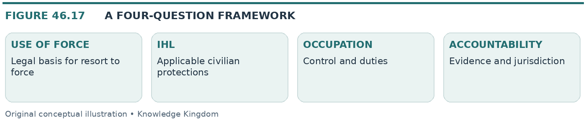

Да предположим, че две измислени щати, Ийстмир и Уестмиър споделят една речна долина. Техните правителства оспорват споразумението за разпределение на водата. Властите на Ийстмиър в крайна сметка изпращат въоръжени сили през признатата граница без съгласието на Уестмир. Те твърдят, че водният спор застрашава икономическата им сигурност. Една безпристрастна организация за оказване на помощ съобщава, че една болница е претоварена, няколко семейства са изчезнали от публичните регистри и разселените жители не могат да получат достатъчно лекарства. Трета държава предлага изпращането на доставки и иска от международен орган да проучи ситуацията. Този пример не представлява нито една истинска държава.

Първото правно разследване се отнася до прибягването до сила. Спорът за водата и икономическата несигурност сами по себе си не установяват въоръжена атака или законно право на нахлуване. Идентифицирайте правилото на Хартата и всяко твърдение за изключение, вместо просто да питате коя страна изглежда по-симпатична. Второто разследване се отнася до хуманитарното право. Въоръжената сила между държавите създава международен въоръжен конфликт; хората, засегнати от него, имат право на приложими защитни мерки независимо от междудържавния спор. Третото разследване се отнася до държавните задължения на всеки орган, упражняващ ефективен контрол над чужда територия. Тези задължения зависят от фактите за контрол, а не от обявяването на суверенитета на органа.

Четвъртото разследване засяга отчетността. Следователят трябва да разграничи надеждните доклади от непотвърдените твърдения, да документира всяко приложимо задължение, да идентифицира всяка отговорна държава или лице и да установи компетентността на институцията, поискана да действа. Докладът на болницата може да покаже спешни нужди, без да установи всеки елемент от криминалното обвинение. Не е необходимо незабавна хуманитарна помощ да чака процес. Четирите запитвания са свързани, но никой не може да замести останалите. Ако можете да ги държите разделени, докато разпознавате как си взаимодействат, сте придобили ценен метод за разбиране на новините за въоръжения конфликт.

<figure class="figure" id="figure-46-17">

<figcaption>Фигура 46.17. Въображаемият случай "Река Валей" обединява четири различни правни разследвания. <a class="figure-anchor" href="#figure-46-17" aria-label="Link to this figure">#</a></figcaption>
</figure>
