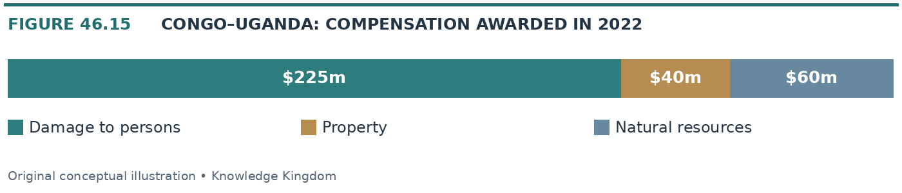

През 2005 г. МС установи, че Уганда е нарушила международните си задължения в Демократична република Конго, включително правилата за използване на сила и задължения, произтичащи от нейното поведение на окупирана територия. Спорът не приключил с това решение. През 2022 г. Палатата определи компенсация на обща стойност 325 млн. щатски долара, разделена на 225 млн. долара за щети на лица, 40 млн. долара за щети на имущество и 60 млн. долара за природни ресурси. \[<a href="/046-international-law-and-armed-conflict/sources/#source-48" class="cite">48</a>\]

Категориите показват, че вредата от войната не може да бъде представена само чрез изгубено оборудване или повреждане на правителствени сгради. Хората страдат от нараняване, преместване, изгубени домове и унищожени поминък. Природните ресурси могат да бъдат използвани по време на конфликт; това може да промени икономическите отношения и да лиши общностите от бъдещи ползи. Квантирането на такива щети години по - късно включва трудни проблеми с доказателствата. Обезщетението е правен отговор, а не твърдение, че парите могат да заменят живота на човек или да заличат миналото.

От това следва, че в решението от 2005 г. и в решението от 2022 г. за репарациите се посочва също така, че съдилищата действат по различен времеви интервал от политически кризи. Прекратяването на огъня, мирното споразумение, съдебното решение и действителното плащане могат да се извършват по различно време. Дали репарацията достига до хората, за които е предназначена, е допълнителен въпрос. По-широкият урок е, че краят на активната борба не слага край на правните последици от конфликта. Глави 49 и 50 ще се върнат към връзката между историческата вреда, репарациите, политическите институции и възстановяването.

<figure class="figure" id="figure-46-15">

<figcaption>Фигура 46.15. $325 милиона в съдебни компенсации, разделени на три категории. Източник: ICJ \[48\]. <a class="figure-anchor" href="#figure-46-15" aria-label="Link to this figure">#</a></figcaption>
</figure>
