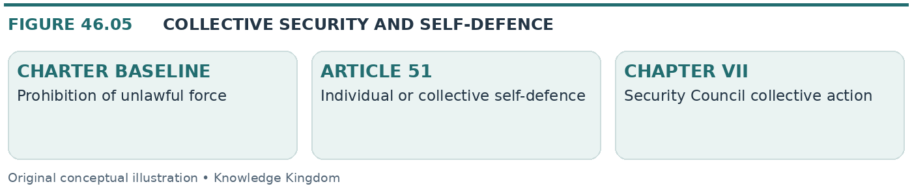

Глава VII от Хартата дава на Съвета за сигурност правомощия да определя заплахите за мира, нарушенията на мира и актовете на агресия. Той може да приеме мерки, които не включват въоръжени сили, като например определени санкции, и може да разреши сила, когато условията на Хартата са изпълнени. Решенията на Съвета се различават по езика, правната основа, обхвата и продължителността. Фразата, разрешаваща всички необходими средства, често се свързва с разрешение за използване на сила, но цялата резолюция трябва да се чете в контекста. \[<a href="/046-international-law-and-armed-conflict/sources/#source-4" class="cite">4</a>\]

Исторически пример е отговорът на нахлуването в Кувейт в Ирак през 1990 г. Резолюция 678 разрешава на страните-членки да използват сила за прилагане на по-ранни резолюции и възстановяване на мира и сигурността в района. Това показва, че колективното разрешение може да бъде дадено, без съюзът да е върховен правен орган. Това не означава, че всяка по-късна операция в същия регион е била автоматично разрешена. \[<a href="/046-international-law-and-armed-conflict/sources/#source-17" class="cite">17</a>\]

Ветото на петимата постоянни членове може да предотврати съществени действия на Съвета. Общото събрание може да обсъжда и препоръчва колективни мерки, включително чрез извънредни специални сесии, но резолюциите му като цяло не предоставят същия правен орган като разрешение по глава VII. Нито липсата на осъждане от страна на Съвета на доказателства за законност. Тези различия показват напрежението в сърцето на ООН: тя е проектирана да регулира международната власт, като същевременно вгражда политическите привилегии на някои могъщи държави.

<figure class="figure" id="figure-46-5">

<figcaption>Фигура 46.5. Тези правни маршрути не са взаимозаменяеми с политическо одобрение. <a class="figure-anchor" href="#figure-46-5" aria-label="Link to this figure">#</a></figcaption>
</figure>
