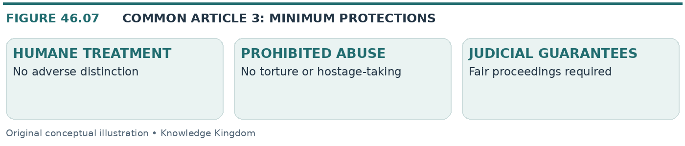

Четирите Женевски конвенции от 1949 г. съдържат идентичен член 3, често наричан общ член 3. Той установява минимални задължения за третиране при въоръжени конфликти, които не са с международен характер. Хората, които не участват активно в военните действия, включително бойците, които са свалили оръжията си или по друг начин са извън битка, трябва да бъдат третирани хуманно без забранени неблагоприятни различия. Сред забранените практики са убийства, мъчения, вземане на заложници, унизително третиране и осъждане или изпълнение без необходимите съдебни гаранции. \[<a href="/046-international-law-and-armed-conflict/sources/#source-24" class="cite">24</a>\]

Статията е особено важна, тъй като вътрешните конфликти в миналото са били третирани като въпроси от вътрешната юрисдикция. Молбата му не предоставя признаване, държавност или политическо право на въоръжена група. Държавата може да продължи да преследва престъпления съгласно националното си право, при спазване на приложимите гаранции. Хуманитарно задължение съществува независимо от тези политически и наказателни въпроси.

Представете си едно село, задържано от организирана въоръжена група, защото групата подозира политическа нелоялност. Липсата на дипломатическо признание на групата не означава, че лицето няма защита съгласно хуманитарното право. Нито задължението на групата да спазва задълженията си зависи от това дали правителството изпълнява собствените си задължения. Подът е предназначен да предотврати низходяща спирала, в която всяка страна оправдава жестокостта си, като посочва поведението на другия. Общата статия 3 е кратка, но институционалната й значимост е огромна: дори гражданската война не е законно празно пространство.

<figure class="figure" id="figure-46-7">

<figcaption>Фигура 46.7. Основните предпазни мерки се прилагат за лица, които не участват активно в военните действия. <a class="figure-anchor" href="#figure-46-7" aria-label="Link to this figure">#</a></figcaption>
</figure>
