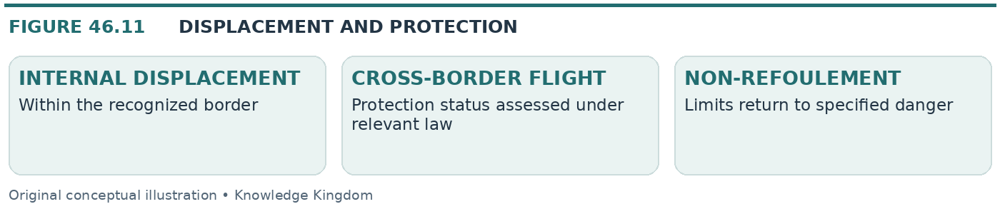

Семейството, принудено да напусне дома си заради борбата, може да бъде преместено вътрешно, ако остане в страната си. Ако премине граница, тя може да се класира за статут на бежанец или друга форма на международна закрила в зависимост от приложимото определение и обстоятелства. Конвентните центрове за бежанци от 1951 г., които се страхуват от преследване поради определени причини; регионалните инструменти и допълнителните режими за защита могат да бъдат насочени към по-широки заплахи, свързани с конфликти и насилие. Не всеки човек, който бяга от войната има еднакъв правен статут. \[<a href="/046-international-law-and-armed-conflict/sources/#source-32" class="cite">32</a>\]\[<a href="/046-international-law-and-armed-conflict/sources/#source-33" class="cite">33</a>\]

Принципът на забрана за връщане на хора на места, където са изправени пред някои сериозни опасности. Точният обхват и изключения зависят от приложимия правен орган; забраната за връщане към реален риск от изтезания съгласно правото в областта на правата на човека е особено строга. Законодателството за бежанците, хуманитарното право и правото за правата на човека може да се припокриват, но те не трябва да се свиват в един правен режим. Човек може да бъде изселен, без да е бежанец в смисъла на договора и може да бъде бежанец дълго след като въоръженият конфликт, който първоначално е причинил полета, приключи.

Принудителното преместване е ограничено от хуманитарен закон. Евакуацията по истински приложими съображения за безопасност или наложителни военни причини е различна от постоянното демографско инженерство. Хуманитарната евакуация не дава право на орган да конфискува домове или да лишава жителите от други защитни мерки. Опитът на разселените хора също илюстрира един централен урок от глава 36: населението не е просто маркер на политическа карта. Домът на човек може да бъде обвързан с препитание, семейство, памет и законни права, които оцеляват при движение през границите.

<figure class="figure" id="figure-46-11">

<figcaption>Фигура 46.11. Правните категории се различават; всички разселени лица запазват приложимите права. <a class="figure-anchor" href="#figure-46-11" aria-label="Link to this figure">#</a></figcaption>
</figure>
