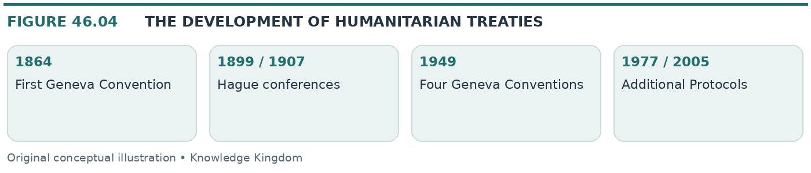

Хагските конференции от 1899 г. и 1907 г. създават договори, свързани отчасти с воденето на война и управлението на окупираната територия. Традиционното разграничение между Хагското право, разглеждащо начина на провеждане на битките, и Женевското право, насочено към жертвите и защитените лица, е полезно историческо късче. Съвременният хуманитарен закон включва и двете, и категориите се припокриват. \[<a href="/046-international-law-and-armed-conflict/sources/#source-11" class="cite">11</a>\]\[<a href="/046-international-law-and-armed-conflict/sources/#source-12" class="cite">12</a>\]

Катастрофите от Втората световна война разкриха огромни пропуски в защитата на цивилни, затворници и други хора под вражески контрол. През 1949 г. правителствата приеха четири Женевски конвенции. Първият засяга ранените и болните въоръжени сили на сушата; вторият адрес е ранен, болен и корабокрушение въоръжени сили в морето; третият се отнася до военнопленници; четвъртият защитава цивилните при съответните обстоятелства, особено тези, които са под властта на неблагоприятна страна или заемат власт. Техните разпоредби са много по-подробни, отколкото тези резюмета предполагат. \[<a href="/046-international-law-and-armed-conflict/sources/#source-2" class="cite">2</a>\]\[<a href="/046-international-law-and-armed-conflict/sources/#source-11" class="cite">11</a>\]

През 1977 г. бяха приети два допълнителни протокола, единият се фокусира главно върху международните конфликти, а другият върху някои вътрешни конфликти. Една трета, приета през 2005 г., въвежда допълнителна отличителна емблема. Четирите конвенции имат универсално държавно участие; Допълнителните протоколи не всички имат еднакво членство. Правилният въпрос е винаги кои договорни разпоредби и обичайни правила се прилагат за засегнатите страни и ситуация. Няма лозунг за Женевските конвенции, който да замени този анализ. \[<a href="/046-international-law-and-armed-conflict/sources/#source-13" class="cite">13</a>\]

<figure class="figure" id="figure-46-4">

<figcaption>Фигура 46.4. Времевата линия на избраните етапи; много други договори също имат значение. <a class="figure-anchor" href="#figure-46-4" aria-label="Link to this figure">#</a></figcaption>
</figure>
