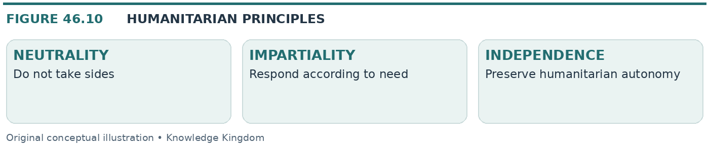

Хуманитарната помощ има за цел да отговори на страданията според нуждите. Организациите могат да предоставят храна, медицинска помощ, подслон, канализация, проследяване на семейството и други услуги. Способността им да работят зависи не само от ресурсите, но и от достъпа до засегнатите популации, гаранциите за сигурност и зачитането на техния персонал. Достъпът е правен и институционален въпрос, а не просто проблем с транспортирането на дарения. \[<a href="/046-international-law-and-armed-conflict/sources/#source-31" class="cite">31</a>\]

Съгласно приложимите хуманитарни правила страните имат основни отговорности по отношение на гражданските нужди и трябва да разрешават и улесняват квалифицираното безпристрастно освобождаване, при спазване на правно значими условия и права на контрол. Изискванията за съгласие не са неограничена сила да се отхвърли облекчение произволно. На окупираната територия Четвъртата Женевска конвенция поставя конкретни задължения по отношение на окупационната власт, включително мерки за облекчение, когато населението е недостатъчно осигурено. Точните договорни задължения зависят от конфликта и обстоятелствата. \[<a href="/046-international-law-and-armed-conflict/sources/#source-2" class="cite">2</a>\]\[<a href="/046-international-law-and-armed-conflict/sources/#source-31" class="cite">31</a>\]

Хуманитарната организация не подкрепя непременно партията, когато преговаря за достъп до нея. Отказът да общуваш с войнствен може понякога да направи помощта невъзможна. Неутралността, безпристрастността и независимостта са различни принципи: неутралитетът се отнася до това да не вземаш страна във военни действия; безпристрастността засяга разпределянето на помощ според нуждите; независимостта засяга автономността на хуманитарните цели от политически или военни цели. Това са институционални практики, предназначени да направят помощта надеждна в дълбоките разделения, а не изявления, че всяка политическа позиция е морално равна. \[<a href="/046-international-law-and-armed-conflict/sources/#source-54" class="cite">54</a>\]

<figure class="figure" id="figure-46-10">

<figcaption>Фигура 46.10. Принципният хуманитарен достъп не е политическо одобрение. <a class="figure-anchor" href="#figure-46-10" aria-label="Link to this figure">#</a></figcaption>
</figure>
