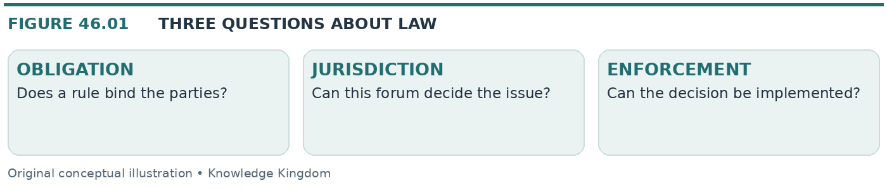

Човек, запознат с вътрешното право, очаква законодателна, полицейска и съдебна власт. Международният спор рядко следва този модел. Няма нито един световен законодателен орган, компетентен да прилага обикновени наказателни закони за всеки човек, без универсален полицейски сили и няма съд с автоматична юрисдикция по всеки спор. Международният правен ред е сравнително децентрализиран. Въпреки това нейните правила не са просто предложения. Правителствата сключват договори, признават обичайните задължения, приемат институционални решения съгласно определени инструменти и редовно се позовават на правото в отношенията си с други държави. \[<a href="/046-international-law-and-armed-conflict/sources/#source-3" class="cite">3</a>\]\[<a href="/046-international-law-and-armed-conflict/sources/#source-4" class="cite">4</a>\]

Помисли за гражданската авиация. Въздухоплавателни средства, принадлежащи на една държава, редовно пресичат територията на друга, не защото пилотите са лично запознати с чужди владетели, а защото правителствата и регулаторите работят в договорени рамки. Дипломатическите привилегии, корабоплаването, търговията и граничните договорености също правят международните задължения част от обикновената администрация. Съществуването на зрелищни нарушения във военно време може да прикрие далеч по-малко грандиозното ежедневно действие на правните ангажименти.

Изяснете три въпроса. Правилата правно обвързващи ли са? Може ли дадена институция да реши дали е била счупена? Възможно ли е решението да бъде изпълнено? Отрицателен отговор на втория или третия не е задължително да се анулира първият. Човек може да дължи дълг дори когато го събира е трудно. От друга страна, дадена институция може да притежава политическа власт, без да бъде упълномощена да я използва по определен начин. Характерната слабост на международното право често не е липса на задължения, а неравномерно разпределение на правомощията и практическия капацитет за прилагане.

<figure class="figure" id="figure-46-1">

<figcaption>Фигура 46.1. Обвързващо правило, компетентен форум и ефективно прилагане са различни неща. <a class="figure-anchor" href="#figure-46-1" aria-label="Link to this figure">#</a></figcaption>
</figure>
