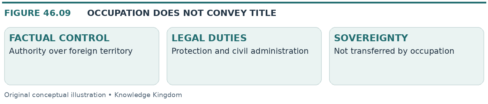

Професията съгласно хуманитарното право е фундаментален въпрос за фактическата власт над чужда територия. Хагските правила от 1907 г. използват идеята за територия, поставена под ръководството на враждебна армия. ICRC описва правното условие по отношение на неконвенционалния ефективен контрол, а не прехвърлянето на териториалния суверенитет. Окупацията може да съществува без активна борба на конкретното място. \[<a href="/046-international-law-and-armed-conflict/sources/#source-29" class="cite">29</a>\]\[<a href="/046-international-law-and-armed-conflict/sources/#source-30" class="cite">30</a>\]

Окупиращата сила придобива задължения, защото упражнява власт над хора, които не могат да разчитат на обикновеното си правителство по същия начин. Законът изисква зачитане на населението и налага задължения относно обществения ред и гражданския живот, здравеопазването, основните доставки и третирането на защитените лица. Тя като цяло запазва съществуващите закони, подлежащи на признати изключения, и не позволява на окупатора да третира територията като своя собствена суверенна собственост. Четвъртата Женевска конвенция ограничава принудителното прехвърляне и депортиране и забранява окупационната власт да прехвърля части от собственото си цивилно население на окупирана територия. \[<a href="/046-international-law-and-armed-conflict/sources/#source-2" class="cite">2</a>\]\[<a href="/046-international-law-and-armed-conflict/sources/#source-29" class="cite">29</a>\]

Съществува важна разлика между законосъобразността на запазването на чуждо присъствие и задълженията, които възникват, докато това присъствие действително съществува. Дори когато окупацията е незаконна, хуманитарните задължения продължават. Декларацията за присъединяване не премахва защитения статут или не заличава закона за окупацията. Доктрината съществува, защото цивилните граждани не трябва да губят защита всеки път, когато спорът за правното заглавие в дома им е нерешен. Колкото по-дълго продължава окупацията, толкова по-голям е рискът една рамка, предназначена да регулира временната власт, да бъде забъркана в опити за постоянна политическа трансформация.

<figure class="figure" id="figure-46-9">

<figcaption>Фигура 46.9. Ефективният контрол поражда задължения без прехвърляне на суверенитет. <a class="figure-anchor" href="#figure-46-9" aria-label="Link to this figure">#</a></figcaption>
</figure>
