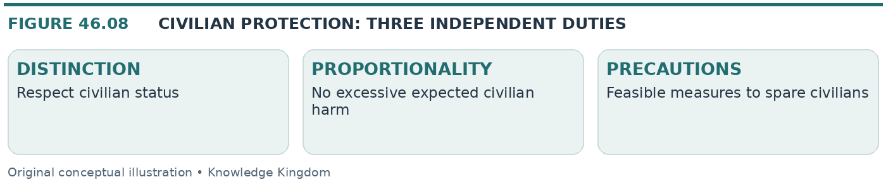

Хуманитарно право забранява очакваната случайна гражданска вреда, която би била прекомерна по отношение на конкретното и пряко военно предимство, очаквано от нападение. Той също така изисква възможни предпазни мерки, за да се избегне или минимизира случайната гражданска вреда. Тези задължения действат редом с принципа на разграничение. Директните нападения срещу цивилни не могат да бъдат правени законно, като се твърди, че те носят достойна политическа полза. \[<a href="/046-international-law-and-armed-conflict/sources/#source-12" class="cite">12</a>\]\[<a href="/046-international-law-and-armed-conflict/sources/#source-26" class="cite">26</a>\]

Правната проверка за пропорционалност не е аритметично съотношение и няма универсален допустим брой цивилни смъртни случаи. Сравнението на броя на убитите хора от противоположни страни не може сама да установи дали инцидентът е бил законен. Обратно, липсата на наблюдавани жертви не означава непременно, че всяко решение е в съответствие със закона. Пропорционалността е свързана с очакваната вреда и очакваното предимство при обстоятелствата, а не само с евентуалния резултат.

Това разграничение не прави резултатите без значение. Последиците от инцидента могат да ускорят разследването, да разкрият неизвестна информация или да проверят дали обясненията са надеждни. Но законът трябва да се прилага с помощта на доказателства за това, което е разумно предвидимо, а не просто да превръщаме погледите в знания, които някой е притежавал по-рано. Публичното докладване често не разполага с необходимите факти. Отговорният читател може да признае тежкото гражданско страдание, да поиска независимо разследване и да откаже да претендира за сигурност относно всеки отделен правен елемент до наличието на достатъчно доказателства. \[<a href="/046-international-law-and-armed-conflict/sources/#source-25" class="cite">25</a>\]\[<a href="/046-international-law-and-armed-conflict/sources/#source-26" class="cite">26</a>\]

<figure class="figure" id="figure-46-8">

<figcaption>Фигура 46.8. Това са допълнителни правила, не числена формула. <a class="figure-anchor" href="#figure-46-8" aria-label="Link to this figure">#</a></figcaption>
</figure>
