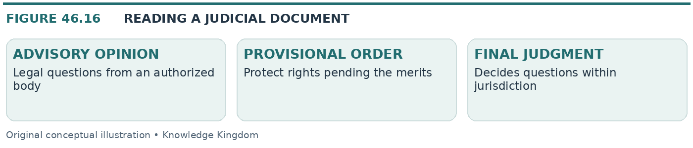

Датираният правен документ може да бъде по-информативен от поток от коментари. На 19 юли 2024 г. МС издаде консултативно становище относно политиките и практиките на Израел в окупираната палестинска територия, включително Източен Йерусалим. Съдът заключава, наред с другото, че продължаващото присъствие на Израел там е незаконно и че той е длъжен да прекрати това присъствие възможно най-бързо. Тя разглежда политиките за уреждане на спорове, практиките, свързани с присъединяването, самоопределението и задълженията на други държави. Някои съдии не бяха съгласни с някои от доводите или заключенията, както показват техните отделни мнения. \[<a href="/046-international-law-and-armed-conflict/sources/#source-49" class="cite">49</a>\]

Тази консултативна процедура беше различна от спорното дело, заведено от Южна Африка срещу Израел съгласно Конвенцията за геноцида. В определението си от 26 януари 2024 г. по второто дело Съдът посочва задължителни временни мерки. Тези мерки имат за цел да запазят правата до произнасянето по делото; заповедта не определя дали е бил извършен геноцид. Това не беше същият вид документ, както мнението на консултантите от юли. \[<a href="/046-international-law-and-armed-conflict/sources/#source-50" class="cite">50</a>\]

Смисълът на това сравнение от дата е процедурна грамотност, а не пълен отчет за конфликта или претенция относно последния етап от производството. Събитията от 7 октомври 2023 г., вземането на заложници, хуманитарната катастрофа в Газа, статутът на окупирана територия и съответните правни аргументи на страните повдигат припокриващи се, но различни въпроси. Гражданската защита обвързва всички заинтересовани страни. Законът не позволява злоупотребите от една страна да оправдават забраненото третиране от друга. Четецът следва да се консултира със съответните решения с дата, да прави разграничение между процедурните етапи и да избягва предоставянето на съдебни заключения, които всъщност не е достигнал.

<figure class="figure" id="figure-46-16">

<figcaption>Фигура 46.16. Формата и датата на решението ви казват какво може да се установи. <a class="figure-anchor" href="#figure-46-16" aria-label="Link to this figure">#</a></figcaption>
</figure>
