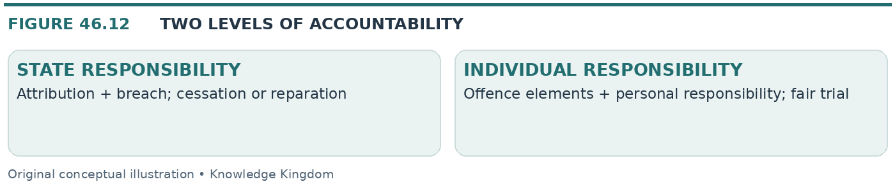

Когато държава наруши международно задължение чрез поведение, което се дължи на нея, може да възникне международна отговорност. Статиите на Международната правна комисия от 2001 г. относно държавната отговорност осигуряват широко използвана рамка за тези въпроси. Те разграничават разпределянето, нарушаването и правните последици от неправомерното поведение. Статиите сами по себе си не са договор; много от техните разпоредби отразяват обичайното право, докато точният им статут може да изисква отделно разглеждане. \[<a href="/046-international-law-and-armed-conflict/sources/#source-41" class="cite">41</a>\]

Атлантида пита дали поведението се третира законно като това на държавата. Поведението от страна на държавните органи обикновено се дължи на държавата, но отговорността за поведението на частни участници или въоръжени групи повдига по-сложни въпроси. Финансирането, политическото съчувствие и правното приписване не са идентични. Държавата може също така да наруши свое задължение, като не предотврати забранено поведение при обстоятелства, при които се прилага съответното мито, дори ако основните актове не са свързани с него.

Последиците могат да включват прекратяване, уверения за неповторение, когато е целесъобразно и репариране. Реституцията се опитва да възстанови предишното положение; обезщетението разглежда подлежащи на оценка загуби; удовлетворението може да включва признание или декларация за нарушение. Тези формуляри могат да бъдат комбинирани. Международното съдебно решение за обезщетение е различно от наказателно наказание срещу длъжностно лице. Наранената държава, засегнатите хора и обвиняемите заемат различни правни позиции. Едно разумно обяснение посочва кой вид отговорност се твърди, вместо да се разглежда цялата отчетност като едно недиференцирано искане за наказание.

<figure class="figure" id="figure-46-12">

<figcaption>Фигура 46.12. Откриването срещу държавата не е само по себе си криминално осъждане. <a class="figure-anchor" href="#figure-46-12" aria-label="Link to this figure">#</a></figcaption>
</figure>
