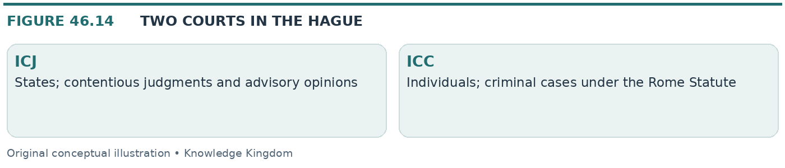

И двете институции седят в Хага, което помага да се обясни защо новините понякога ги объркват. Международният съд (МС) е главният съдебен орган на ООН и се занимава със спорни дела между държавите. Той също така дава консултативни становища, когато това е поискано от упълномощени органи или агенции на ООН в рамките на съответната рамка. Индивидите не могат да повдигат обикновени наказателни дела един срещу друг пред МС. \[<a href="/046-international-law-and-armed-conflict/sources/#source-3" class="cite">3</a>\]

Компетентността на МС в спорни случаи зависи от съгласието на държавата, което може да бъде изразено чрез специални споразумения, клаузи за компетентност по договорите или декларации, които отговарят на изискванията, приемащи юрисдикция. Съгласието може да има ограничения и резерви. Членството на Организацията на обединените нации не установява задължителна компетентност по отношение на всеки възможен спор. Спорното решение е обвързващо между страните по конкретния случай. По принцип консултативните становища не са задължителни като такива, въпреки че техните правни мотиви могат да идентифицират съществуващите обвързващи задължения и да притежават значителен орган. \[<a href="/046-international-law-and-armed-conflict/sources/#source-3" class="cite">3</a>\]\[<a href="/046-international-law-and-armed-conflict/sources/#source-4" class="cite">4</a>\]

За разлика от това МНС определя индивидуалната наказателна отговорност в рамките на своята законова компетентност. Може да се установи, че дадена държава е нарушила международно задължение, без МНС да осъди конкретно лице. Също така, криминалното осъждане не решава автоматично всеки междущатски въпрос. Европейският съд по правата на човека, регионалните съдилища, националните наказателни съдилища и арбитражните трибунали добавят още повече слоеве. Идентифицирането на институцията в заглавие не е тривиална подробност: тя ви казва какъв вид решение може да вземе институцията.

<figure class="figure" id="figure-46-14">

<figcaption>Фигура 46.14. Международният съд и Международният наказателен съд са отделни институции. <a class="figure-anchor" href="#figure-46-14" aria-label="Link to this figure">#</a></figcaption>
</figure>
