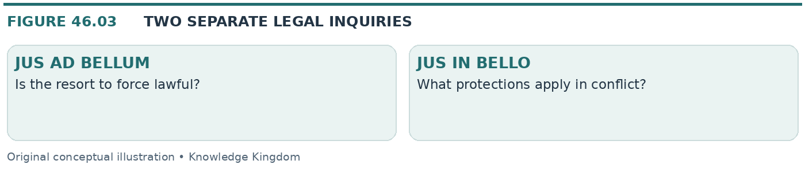

Латинският израз jus ad bellum се отнася до правните правила за прибягване до сила. В Бело, често наричано международно хуманитарно право (IHL), се отнасят до правилата, приложими по време на въоръжени конфликти. Международното право в областта на правата на човека и международното наказателно право също могат да се прилагат, но те задават допълнителни въпроси. Следователно едно-единствено събитие може да доведе до няколко отделни съдебни производства. \[<a href="/046-international-law-and-armed-conflict/sources/#source-4" class="cite">4</a>\]\[<a href="/046-international-law-and-armed-conflict/sources/#source-8" class="cite">8</a>\]

Да предположим, че държава А незаконно нахлува в държавата Б. Въпреки това силите му остават обвързани с хуманитарната защита. Заловен член на армията на А може да не бъде измъчван само защото А е започнал войната. Също така, войник от нахлуващата държава, който се отнася към задържаните по хуманен начин, не прави инвазията законна. Индивидуалното поведение и междущатското решение за използване на сила трябва да бъдат оценени поотделно.

Тази раздяла понякога се описва като равенство на войнствените лица съгласно хуманитарното право. Не е декларация, че и двете политически причини са еднакво справедливи. Нито пък означава, че нарушенията са еднакво многобройни или сериозни от всяка страна. Това означава, че правните гаранции не се разпределят според политическата симпатия. Когато четеш новина, попитай кой въпрос всъщност се разглежда. Дали коментаторът преценява произхода на конфликта, инцидента по време на него, отговорността на държавата или вината на индивида? Доводите стават по-ясни, след като се идентифицират техните категории.

<figure class="figure" id="figure-46-3">

<figcaption>Фигура 46.3. Хуманитарните задължения не зависят от политическата справедливост на кауза. <a class="figure-anchor" href="#figure-46-3" aria-label="Link to this figure">#</a></figcaption>
</figure>
