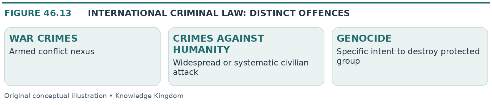

Военното престъпление не е просто неморално действие, извършено по време на война. Международното наказателно право изисква елементите на признато престъпление, включително съответната връзка с въоръжен конфликт, когато това е необходимо. Престъпленията срещу човечеството, съгласно Римския статут, включват конкретни действия, извършени като част от широко разпространена или систематична атака, насочена срещу цивилно население, с необходимите познания. Те не трябва да се случват по време на въоръжен конфликт. Контекстните изисквания се различават от тези на военните престъпления. \[<a href="/046-international-law-and-armed-conflict/sources/#source-20" class="cite">20</a>\]\[<a href="/046-international-law-and-armed-conflict/sources/#source-43" class="cite">43</a>\]

Геноцидът има специално правно определение съгласно Конвенцията от 1948 г. Той засяга конкретни действия, извършени с цел да се унищожи изцяло или частично защитена национална, етническа, расова или религиозна група като такава. Доказването на това специално намерение е отличително и често изисква правно разследване. Гравитацията на зверството не зависи от това дали в крайна сметка е класифицирано като геноцид. Престъпленията срещу човечеството и военните престъпления могат да бъдат изключително тежки. \[<a href="/046-international-law-and-armed-conflict/sources/#source-44" class="cite">44</a>\]

Терминът етническо прочистване обикновено описва насилственото отстраняване на населението от дадена област на етнически или подобни основания. Това не е отделно единствено престъпление в Римския статут, въпреки че действията, описани с термина, могат да задоволят елементи от признати престъпления. Тези различия не са опит да се определи страданието на жертвите. Те имат значение, тъй като наказателното правосъдие трябва да даде справедливо предизвестие по обвинението, да докаже необходимите елементи и да идентифицира приложимата юрисдикция. Използването на най-емоционално силния термин за всяко зверство може да замъгли доказателствата, необходими за установяване на отговорност.

<figure class="figure" id="figure-46-13">

<figcaption>Фигура 46.13. Различни правни елементи; възможно е припокриване на поведението. <a class="figure-anchor" href="#figure-46-13" aria-label="Link to this figure">#</a></figcaption>
</figure>
