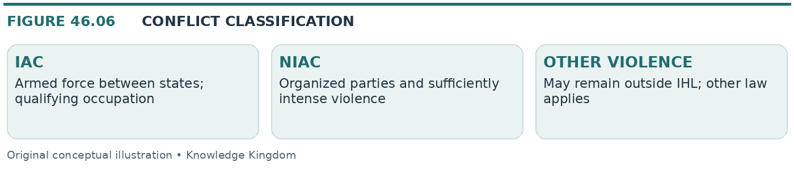

Хуманитарен закон се прилага, когато фактите отговарят на прага на въоръжен конфликт. Тя не зависи от обявяване на война, предпочитаната терминология на правителството или официалното признаване на противника. Като цяло въоръжените сили между държавите предизвикват международен въоръжен конфликт (IAC); законът се прилага и по отношение на окупацията, обхваната от конвенциите, дори и при липса на борба. \[<a href="/046-international-law-and-armed-conflict/sources/#source-2" class="cite">2</a>\]\[<a href="/046-international-law-and-armed-conflict/sources/#source-22" class="cite">22</a>\]

Немеждународен въоръжен конфликт (NIAC) обикновено включва достатъчно интензивно насилие и достатъчно организирани партии, които могат да бъдат държавни сили и организирани въоръжени групи или противоположни организирани групи. Един изолиран акт на насилие или обикновено обществено безредие не трябва да се равнява на такъв конфликт. Допълнителният протокол II има по-взискателен специфичен праг на договора, включително изисквания относно контрола на организираната въоръжена група върху територията и способността за извършване на трайни операции. Не всеки NIAC е обхванат от този протокол. \[<a href="/046-international-law-and-armed-conflict/sources/#source-13" class="cite">13</a>\]\[<a href="/046-international-law-and-armed-conflict/sources/#source-22" class="cite">22</a>\]

Какво значение има това разграничение? Приложимите данни за договора, режимите на задържане и правния статут на бойците могат да се различават, въпреки че основните хуманитарни гаранции се прилагат и в двата случая. Няколко конфликта от различни правни видове могат да съществуват съвместно в един географски регион, особено когато става дума за чуждестранни държави. Анализаторите не трябва да приемат, че един политически етикет урежда всяка връзка. Решението на МНСБЮ от 1995 г. за юрисдикцията на Тадич помогна да се изрази съвременният подход към класификацията и постигането на хуманитарното право. \[<a href="/046-international-law-and-armed-conflict/sources/#source-23" class="cite">23</a>\]

<figure class="figure" id="figure-46-6">

<figcaption>Фигура 46.6. Класификацията зависи по-скоро от фактите, отколкото от етикета, използван от правителствата. <a class="figure-anchor" href="#figure-46-6" aria-label="Link to this figure">#</a></figcaption>
</figure>
