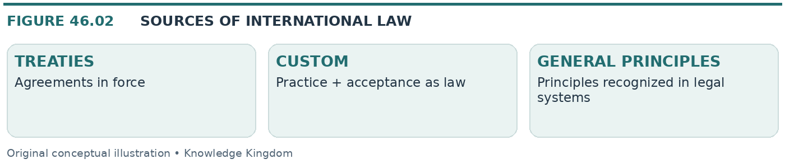

Член 38 от Статута на Международния съд е полезна отправна точка за традиционните източници на международно право. Договорите са споразумения, уредени от международното право. Персонализираното право произтича от достатъчно обща практика, приета като законово изисквана или разрешена. Общите принципи, признати в правните системи, могат да помогнат за предоставяне на правни мотиви. Съдебните решения и работата на квалифицирани учени служат като дъщерно средство за определяне на правила, а не автоматично легализиране за всяка държава. \[<a href="/046-international-law-and-armed-conflict/sources/#source-3" class="cite">3</a>\]\[<a href="/046-international-law-and-armed-conflict/sources/#source-5" class="cite">5</a>\]

Договорът може да обвързва страните си, но не и страни, които не са страни, само защото текстът му съществува. Съответно обичайно правило може, независимо, да се прилага по-широко. В глава 4 научихме, че архивът не се тълкува сам. Същото важи и за дипломатически архив: адвокатът трябва да проучи формулировката, ратифицирането, резервите, практиката и спорния въпрос. Подписът, ратифицирането и влизането в сила не са непременно едно и също събитие.

Персонализирането е особено лесно за неразбиране. Ако много държави направят нещо от удобство, повторението само по себе си не доказва, че смятат практиката за правно задължителна. Заключенията на Международната комисия по право от 2018 г. отличават практиката от приемането като закон, често наричано опинио юрис. Обратно, държава, която отрича, че е извършила забранено действие, може безрезервно да потвърди правилото, че е обвинена в нарушаване. Създаването на обичай изисква разглеждане на по - широк набор от доказателства, а не просто отчитане на примери, благоприятни за предпочитан аргумент. \[<a href="/046-international-law-and-armed-conflict/sources/#source-5" class="cite">5</a>\]\[<a href="/046-international-law-and-armed-conflict/sources/#source-6" class="cite">6</a>\]

<figure class="figure" id="figure-46-2">

<figcaption>Фигура 46.2. В член 38 също така се посочват спомагателните средства за определяне на правилата. <a class="figure-anchor" href="#figure-46-2" aria-label="Link to this figure">#</a></figcaption>
</figure>
