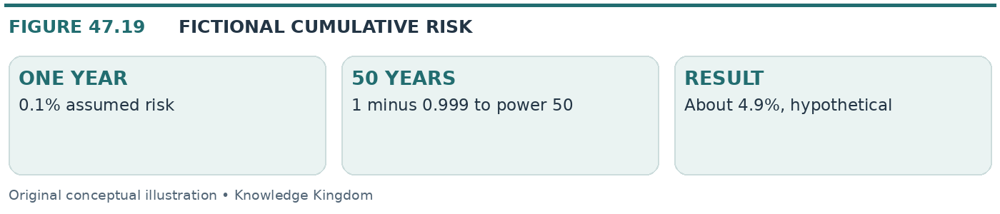

Да предположим, че една измислена институция има един-в-едно-хилядна възможност за сериозен провал през всяка година, при изкуствено предположение, че вероятността остава постоянна и събитията в различни години са независими. Това е пример за вероятности в класната стая, а не прогноза за ядрена война. Според тези предположения вероятността за избягване на провала за една година е 0,999. Вероятността за избягването му в продължение на петдесет години е 0,99, вдигната на петдесета степен, приблизително 0,951. Следователно шансът за поне един провал е около 4,9%.

Упражнението илюстрира защо малката годишна вероятност не трябва да остава малка за дълъг период. Но предположенията са критични. Историческите кризи не са непременно независими, политическите институции се променят и годишната вероятност за катастрофално събитие не е нещо, което можем да установим, като гледаме само броя на годините без такова. Продължителен период на мир може да даде доказателства за някои аспекти на поведението на една система, без да се установи точна вероятност за бъдещ провал.

За втора илюстрация, да предположим, че първоначалната вероятност е несигурна и един анализатор избра стойност десет пъти по-голяма от друга. Дългосрочните оценки ще се различават значително, дори ако и двамата анализатори използват една и съща аритметика правилно. Цифровата изтънченост не може да компенсира неподкрепените входове. Това ни връща към глава 3: математическо изчисление може да бъде точно по отношение на неговите предположения, докато неговото значение за света остава несигурно. При дебатите за ядрения риск липсата на точна вероятност не следва да се бърка с липсата на сериозна опасност. Нито пък измислената вероятност да бъде представена като емпирична прогноза.

<figure class="figure" id="figure-47-19">

<figcaption>Фигура 47.19. Илюстративна независимо-събитие аритметика, а не ядрена-война прогноза. <a class="figure-anchor" href="#figure-47-19" aria-label="Link to this figure">#</a></figcaption>
</figure>
