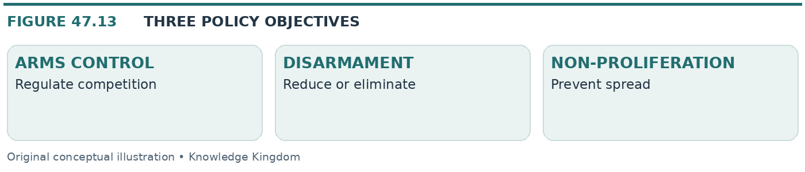

Контролът на оръжията засяга договорени ограничения или други мерки, предназначени за регулиране на военната конкуренция и намаляване на опасността. Обезоръжението се отнася до намаляването или премахването на оръжията и свързаните с тях способности. Неразпространението засяга предотвратяването на разпространението им. Концепцията се припокрива, но едно споразумение може да преследва една цел, без да постигне другите. Договор, който забранява дадена категория тестове, може да подобри международната сигурност, без да изисква премахването на съществуващите арсенали. Намаляване на запасите може да се случи, докато международните отношения остават напрегнати.

Тези различия обясняват защо правителствата с много различни дългосрочни видения понякога могат да си сътрудничат. Държава, ангажирана с задържането на ядрени оръжия в обозримо бъдеще, въпреки това може да приеме ограничения, предназначени да намалят несигурността или да предотвратят неконтролирана надпревара за оръжие. Правителството, което иска премахване, може да подкрепи междинните споразумения, защото те намаляват опасността, докато по-широките преговори продължават. Наличието на частично споразумение не означава непременно, че участниците споделят една и съща крайна цел.

Критиците на контрола на оръжията понякога твърдят, че договорените ограничения могат да легитимират или да затвърдят оръжията, на чието съществуване те се противопоставят. Защитниците отговарят, че намаляването на непосредствената опасност има независима стойност и че допълнителните мерки могат да създадат условия за по-дълбоко сътрудничество. Това е истинско политическо несъгласие, а не обикновен спор за определения. Важно е да се направи разграничение дали дадено споразумение е ефективно по отношение на заявената му цел, дали тази цел е достатъчно амбициозна и дали споразумението засяга перспективите за бъдещо разоръжаване. Договорът може да бъде ценен в едно измерение и разочароващ в друго. \[<a href="/047-deterrence-and-nuclear-strategy/sources/#source-25" class="cite">25</a>\]\[<a href="/047-deterrence-and-nuclear-strategy/sources/#source-32" class="cite">32</a>\]\[<a href="/047-deterrence-and-nuclear-strategy/sources/#source-42" class="cite">42</a>\]

<figure class="figure" id="figure-47-13">

<figcaption>Фигура 47.13. Споразумението може да допринесе за повече от една цел. <a class="figure-anchor" href="#figure-47-13" aria-label="Link to this figure">#</a></figcaption>
</figure>
