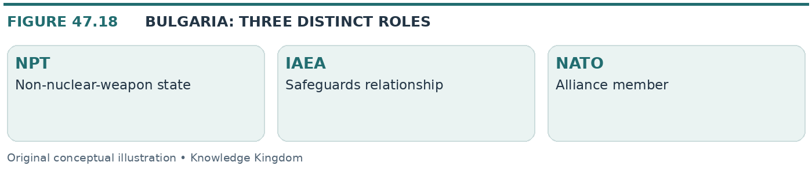

България е полезен случай, защото ядрената политика не се ограничава само до държави, които притежават ядрени оръжия. Страната участва в международни споразумения за неразпространение на ядрено оръжие като държава, която не е въоръжена съгласно ДНЯО, има граждански ядрени енергийни институции и е член на НАТО от 2004 г. насам и Европейския съюз от 2007 г. Тези отношения засягат различни правни и политически отговорности. Те не трябва да се сринат в нито едно твърдение за ядрен статус.

Българските защитни отношения с Международната агенция за атомна енергия са част от международната рамка, уреждаща мирните ядрени дейности. Производството на електроенергия в страната и регулирането на ядрената безопасност включват различни въпроси относно инженерството, икономиката, публичната администрация и отговорността за околната среда. Човек, който обсъжда българската ядрена енергия, трябва да може да разграничи гражданската роля на електроцентрала от политическата роля на ядреното възпиране в рамките на съюза. Наличието на граждански ядрени технологии не е доказателство, че една държава притежава ядрени оръжия.

Като член на НАТО България участва в колективни решения за сигурност и консултации съгласно институционалната рамка на Алианса. Това не го прави независима държава с ядрено оръжие, нито пък Северноатлантическият договор предписва автоматичен ядрен отговор на всяка криза. Българските граждани имат законни интереси в енергийната политика на страната, договорните задължения, дипломатическите ангажименти и по-широките хуманитарни последици от ядрения риск. Пълното обсъждане на националната сигурност включва публична отчетност и информиран демократичен дебат, вместо да разглежда тези въпроси като изключителна грижа за големите правомощия. \[<a href="/047-deterrence-and-nuclear-strategy/sources/#source-19" class="cite">19</a>\]\[<a href="/047-deterrence-and-nuclear-strategy/sources/#source-20" class="cite">20</a>\]\[<a href="/047-deterrence-and-nuclear-strategy/sources/#source-32" class="cite">32</a>\]\[<a href="/047-deterrence-and-nuclear-strategy/sources/#source-58" class="cite">58</a>\]\[<a href="/047-deterrence-and-nuclear-strategy/sources/#source-63" class="cite">63</a>\]\[<a href="/047-deterrence-and-nuclear-strategy/sources/#source-64" class="cite">64</a>\]

<figure class="figure" id="figure-47-18">

<figcaption>Фигура 47.18. Гражданската ядрена енергия и членството в съюза са различни от притежанието. <a class="figure-anchor" href="#figure-47-18" aria-label="Link to this figure">#</a></figcaption>
</figure>
