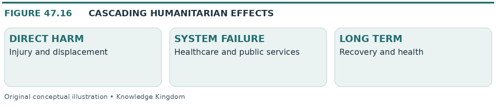

Хуманитарни последици от използването на ядрено оръжие не се ограничават до незабавна физическа вреда. Международният комитет на Червения кръст подчертава изключителната трудност да се предостави адекватна помощ след ядрена детонация в или близо до населен район. Здравните системи, транспортът, комуникациите и основните обществени услуги могат сами да бъдат повредени точно когато търсенето на помощ стане най-голямо. Хората, които преживеят първоначалното бедствие, могат да се изправят пред продължителна борба за медицински грижи, подслон, чиста вода и възстановяване на обикновения живот.

Свързаните с радиацията ефекти върху здравето изискват внимателна научна интерпретация. Рисковете зависят от експозицията и индивидуалните обстоятелства, а не всяко заболяване в засегнатото население може автоматично да се отдаде на радиацията. Обратно, липсата на непосредствен симптом не установява липса на дългосрочен риск. Поради това епидемиологичните изследвания, надеждните записи на експозицията и дългосрочните последващи действия са важни. Целта на признаването на несигурността е да се подобри качеството на решенията в областта на общественото здраве, а не да се намали опитът на хората, които са страдали.

Има по-дълбок институционален проблем. Голяма част от обикновената аварийна готовност предполага, че помощта може да дойде от действащи съседни общности или национални институции. Катастрофа, която засяга тези институции по същото време, когато хората, които се нуждаят от помощ, подкопава това предположение. Това е системен проблем от вида, описан в глава 7: няколко основни мрежи могат да се провалят заедно, умножавайки ефектите от първоначалното събитие. Поради това хуманитарните агенции подчертават превенцията, вместо да предполагат, че може надеждно да се гарантира адекватен отговор. \[<a href="/047-deterrence-and-nuclear-strategy/sources/#source-1" class="cite">1</a>\]\[<a href="/047-deterrence-and-nuclear-strategy/sources/#source-2" class="cite">2</a>\]\[<a href="/047-deterrence-and-nuclear-strategy/sources/#source-52" class="cite">52</a>\]

<figure class="figure" id="figure-47-16">

<figcaption>Фигура 47.16. Множество социални системи могат да бъдат засегнати заедно. <a class="figure-anchor" href="#figure-47-16" aria-label="Link to this figure">#</a></figcaption>
</figure>
