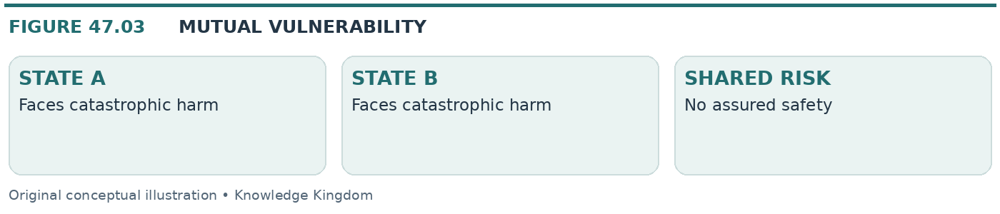

Терминът взаимно гарантирано унищожаване, обикновено съкратено до MAD, описва състояние, при което съперничещите ядрени сили всеки от тях е изправен пред перспективата за разрушителна вреда, ако се случи ядрена война между тях. Политическият извод е, че победата става изключително трудна за определяне във всеки обикновен смисъл. Държава, чието общество, институции и икономика са били опустошени, няма причина да празнува абстрактен военен успех. Следователно взаимната уязвимост се намира в основата на много обяснения за въздържанието от Студената война.

MAD често се представя като договор, официална общоприета доктрина или гаранция за мир. Не е нито едно от тези неща. Правителствата и учените не са съгласни какво означава взаимна уязвимост, колко стабилна е тя и дали зависимостта от нея е морално защитена. Някои национални доктрини са подчертали различни видове уверения или задължения и езикът им се е променил с течение на времето. Изразът се разбира най-добре като аналитичен стенограф за връзка, а не като описание на единна политика, споделена от всички ядрени държави.

Полезно разграничение е между предложение за стимули и предложение за резултати. Човек може да твърди, че страхът от опустошение прави умишлено започнала ядрена война по-малко привлекателна. Не следва, че ядрената война е невъзможна. Грешките, недоразуменията, инцидентите, вътрешната нестабилност и решенията, взети под изключителен натиск, могат да прекъснат очакваната връзка между стимулите и поведението. Освен това едно правителство може да вярва, че съперникът е по-склонен да приеме риска, отколкото всъщност е. Теоретичното равновесие не е сертификат за безопасност. \[<a href="/047-deterrence-and-nuclear-strategy/sources/#source-3" class="cite">3</a>\]\[<a href="/047-deterrence-and-nuclear-strategy/sources/#source-12" class="cite">12</a>\]\[<a href="/047-deterrence-and-nuclear-strategy/sources/#source-13" class="cite">13</a>\]

Публичната доктрина също се нуждае от внимателно тълкуване. Първото използване означава започване на ядрена употреба в конфликт, докато залог без първа употреба е ангажимент да не бъде първият, който го прави. Отмъщението често се обсъжда с термина "втора стачка"; изразът описва отговор, който не е законно право на безразборна вреда. Китай публично потвърди своята политика без първо използване и Индия описа собствената си политика по подобен начин, въпреки че формулировката и квалификацията на националните ангажименти могат да се различават. Отрицателните гаранции за сигурност са обещания, свързани с неупотребата или незаплахата на ядрени оръжия срещу неядрени държави. Националната декларация, двустранното споразумение и обвързващият международен договор имат различна правна сила. Значението на всеки залог трябва да се разглежда чрез точните му условия, институционален контекст и надеждност, а не само чрез етикета му. \[<a href="/047-deterrence-and-nuclear-strategy/sources/#source-60" class="cite">60</a>\]\[<a href="/047-deterrence-and-nuclear-strategy/sources/#source-61" class="cite">61</a>\]\[<a href="/047-deterrence-and-nuclear-strategy/sources/#source-62" class="cite">62</a>\]

<figure class="figure" id="figure-47-3">

<figcaption>Фигура 47.3. Взаимната уязвимост не е гаранция за мир. <a class="figure-anchor" href="#figure-47-3" aria-label="Link to this figure">#</a></figcaption>
</figure>
