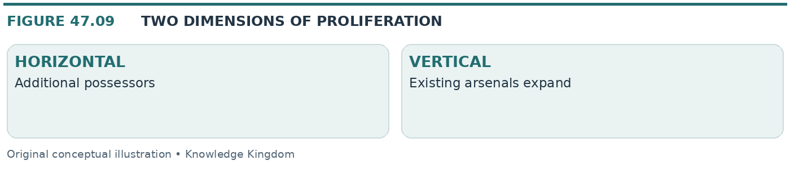

Разпространението се отнася до разпространението на ядрени оръжия за допълнителни участници. Анализаторите понякога разграничават хоризонталното разпространение, което означава придобиване от допълнителни държави, от вертикално разпространение, което се отнася до експанзия или развитие на арсенали от съществуващите ядрени сили. Разграничаването изяснява проблема с конкретна политическа мярка. Предотвратяването на появата на допълнително ядрено-въоръжено състояние не е идентично с намаляването на съществуващите запаси.

Държавите са преследвали ядрени оръжия по различни причини. Сигурността срещу възприеманите заплахи е важно обяснение, но това не обяснява всички различия. Вътрешните институции, научните общности, националния статут, лидерските приоритети и символичното значение на технологичното постижение могат да повлияят на решенията. От друга страна, дадена държава може да притежава научния опит, свързан с напреднали мирни ядрени дейности, без да избере да придобие ядрени оръжия. Политическите намерения не могат да бъдат изведени просто от нивото на технологично развитие на дадена държава.

Влиятелният анализ на разпространението на Скот Сейгън определя сигурността, вътрешните политически интереси и норми като различни обяснителни модели. Особено полезен въпрос е защо държавите с очевидно сравними външни заплахи понякога правят различни избори. Един може да търси надежден съюз, друг може да подчертае законния неутралитет, а друг да се стреми към независими способности. Едно историческо обяснение следва да разгледа конкретните институции за вземане на решения и международните отношения, вместо да приема, че всички правителства ценят едни и същи неща. По същия начин намаляването на риска от разпространение не е само технически проблем; то включва договорености за сигурност, надеждни международни институции и легитимността на самите глобални правила. \[<a href="/047-deterrence-and-nuclear-strategy/sources/#source-9" class="cite">9</a>\]\[<a href="/047-deterrence-and-nuclear-strategy/sources/#source-30" class="cite">30</a>\]\[<a href="/047-deterrence-and-nuclear-strategy/sources/#source-31" class="cite">31</a>\]

<figure class="figure" id="figure-47-9">

<figcaption>Фигура 47.9. Различни аспекти на проблема с разпространението. <a class="figure-anchor" href="#figure-47-9" aria-label="Link to this figure">#</a></figcaption>
</figure>
