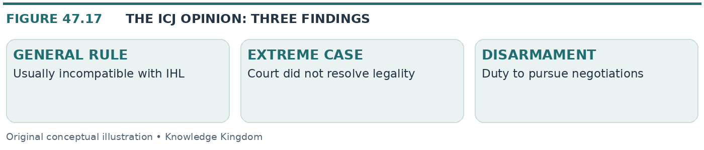

Глава 46 отличава закона, уреждащ прибягването до сила от хуманитарното право, регулиращо поведението по време на въоръжен конфликт. И двете правни органи имат отношение към ядрените оръжия. През 1996 г. Международният съд даде консултативно становище относно законосъобразността на тяхната заплаха или употреба, в отговор на въпрос от Общото събрание на ООН. Становището е важен правен документ, но често се обобщава по-категорично от действителните заключения.

Съдът установи, че заплахата или използването на ядрени оръжия като цяло би било в противоречие с правилата на международното право, приложими във въоръжени конфликти, по-специално хуманитарното право. Тя също така заяви, че не може да заключи окончателно дали подобна заплаха или използване ще бъде законна или незаконна при екстремни обстоятелства на самозащита, в които оцеляването на държава би било заложено на карта. Това беше нерешено заключение в становището, а не положително разрешение за ядрена употреба при тези обстоятелства. Съдът отделно потвърди задължението да се преследва добросъвестно и да се водят преговори за приключване, водещи до ядрено разоръжаване под ефективен международен контрол.

Консултантските становища са различни от наказателното решение или договора за създаване на нови договорни ангажименти. Нейните правни мотиви носят авторитет, но трябва да се чете с точния си език, поставения въпрос и последващото развитие на международното право. Договорът за забрана от 2017 г. създава допълнителни специфични задължения за своите страни. Призоваването на страната за самозащита не заличава приложимите изисквания на хуманитарното право и правното третиране на заплахата не може да се установи просто като я нарече възпиране. \[<a href="/047-deterrence-and-nuclear-strategy/sources/#source-54" class="cite">54</a>\]\[<a href="/047-deterrence-and-nuclear-strategy/sources/#source-55" class="cite">55</a>\]

<figure class="figure" id="figure-47-17">

<figcaption>Фигура 47.17. Неразрешеният въпрос не е разрешение. <a class="figure-anchor" href="#figure-47-17" aria-label="Link to this figure">#</a></figcaption>
</figure>
