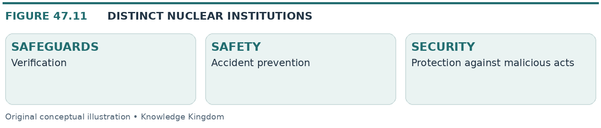

Ядрената наука използва повече от оръжия. Електричеството, медицинската диагностика и лечение, научните изследвания, промишлените приложения и селскостопанските науки всички използват знания, свързани с атомни процеси. Следователно една международна система, занимаваща се с неразпространението, е изправена пред трудна задача: тя трябва да разграничи забраненото военно придобиване от законно мирно сътрудничество, без да третира всички ядрени дейности като умишлено незаконни.

Международната агенция за атомна енергия, създадена през 1957 г., изпълнява централна роля в международната проверка съгласно споразумения за гаранции. Предпазителите са мерки, предназначени да помогнат за установяване дали държавите спазват съответните ангажименти по отношение на ядрения материал и дейностите. Правният орган, с който разполага агенцията, зависи от приложимите споразумения и други мандати. Нейните констатации следва да бъдат разбрани по отношение на този орган и доказателствата, които действително са на разположение на неговите инспектори и анализатори.

Защитните мерки не са идентични с ядрената безопасност или ядрената сигурност. Безопасност, предотвратяваща произшествия и защита на хората и околната среда от рискове от радиация. Сигурността засяга защитата срещу злонамерени действия и неоторизиран достъп. Защитните мерки се отнасят до проверка на посочените задължения за неразпространение. Тези дейности могат да бъдат свързани, но всяка от тях има различна институционална цел. Електростанцията може да изпълни задължение за гаранции, докато е изправена пред отделен въпрос за нейната безопасност в инженерното пространство, а инцидентът с безопасността сам по себе си не създава оръжейна програма. От съществено значение е да се отбележат категориите, когато се чете публично обсъждане на ядрените съоръжения. По-широкият урок е, че надеждната проверка подкрепя мирното сътрудничество, вместо непременно да го възпрепятства. \[<a href="/047-deterrence-and-nuclear-strategy/sources/#source-33" class="cite">33</a>\]\[<a href="/047-deterrence-and-nuclear-strategy/sources/#source-34" class="cite">34</a>\]

<figure class="figure" id="figure-47-11">

<figcaption>Фигура 47.11. Трите функции са свързани, но не и синоним. <a class="figure-anchor" href="#figure-47-11" aria-label="Link to this figure">#</a></figcaption>
</figure>
