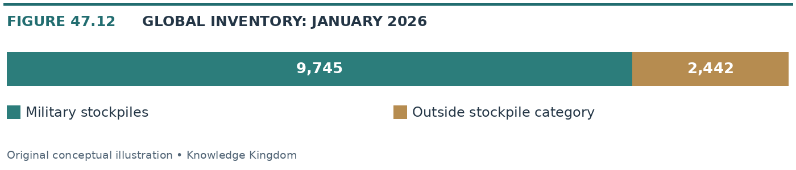

Стокхолмският международен институт за изследване на мира изчислява, че девет държави притежават приблизително 12,187 ядрени оръжия през януари 2026 г. От тях около 9 745 са били във военни запаси за потенциална употреба. Останалите бяха извън тази категория, включително пенсионираните оръжия в очакване на разглобяване. Това са обобщени оценки, а не точно преброяване. Тяхната дата има значение: цифра за януари не трябва да се описва като преброяване на живо през ноември. \[<a href="/047-deterrence-and-nuclear-strategy/sources/#source-40" class="cite">40</a>\]\[<a href="/047-deterrence-and-nuclear-strategy/sources/#source-41" class="cite">41</a>\]

Разликата между инвентара и запасите е от значение, защото различните доклади броят различни неща. Заглавията могат да обявят увеличение в една категория, докато по-дългосрочната съвкупност намалява, защото пенсионираните оръжия биват демонтирани. Друг доклад може да се съсредоточи върху оръжията, обхванати от конкретно споразумение, а не върху общата инвентаризация. Цифрите могат да бъдат съвместими, ако техните категории и дати се различават. Първо читателят трябва да попита какво е включено и какво е изключено, а след това да помисли какво сравнение е подходящо.

Ето един прост аритметичен пример с помощта на тези публикувани оценки. Изваждането на 9,745 от 12,187 дава приблизително 2,442 оръжия извън категорията военни запаси, или приблизително една пета от прогнозната обща стойност. Това не означава, че всяко оръжие в останалата част е идентично по статут, нито изчислението прави базовите оценки по-прецизни. Тя илюстрира как може да се получи полезно число от несигурни данни, като същевременно се запази първоначалната несигурност. Преброяванията са доказателство за мащаба на проблема, а не пълна мярка за опасност, политически намерения или хуманитарни последици. Концентрацията на глобални разрушителни способности остава загриженост дори когато числените категории са трудни за сравняване.

<figure class="figure" id="figure-47-12">

<figcaption>Фигура 47.12. SIPRI оценки: 9,745 във военни запаси; 2,442 извън тази категория; общо 12,187 \[40\]. <a class="figure-anchor" href="#figure-47-12" aria-label="Link to this figure">#</a></figcaption>
</figure>
