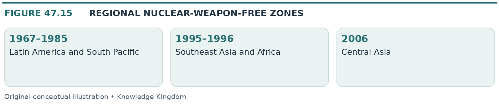

Лесно е да се разглежда международния ядрен ред като нещо, проектирано изключително във Вашингтон, Москва, Лондон, Париж или Пекин. Историята на зоните без ядрено оръжие предизвиква тази гледна точка. Групи от държави договориха регионални договори за ограничаване на ядрените оръжия на собствените си територии и за създаване на институции или процедури в подкрепа на техните ангажименти. Тези споразумения дават на регионалните участници начин да определят аспектите на собствената си сигурност, а не просто да приемат договорености, създадени от далечни сили.

Договорът от Tlatelolco бе открит за подписване през 1967 г. и създаде зона без ядрено оръжие в Латинска Америка и Карибите. Последващите споразумения включват Договора от Раротонга за Южния Тихи океан, Договорът от Банкок за Югоизточна Азия, Договорът от Пелиндаба за Африка и Договора за създаване на зона без ядрено оръжие в Централна Азия, подписан в Семипалатински през 2006 г. Техните разпоредби и географски определения се различават. Някои от тях съдържат протоколи, чрез които държавите с ядрено оръжие могат да поемат допълнителни задължения към региона. Самите протоколи могат да включват квалификации, резерви или разногласия относно тълкуването.

Постигането на тези споразумения е отчасти в техния регионален произход. Споделената норма на сдържаност може да помогне на държавите да установят очаквания за поведението на своите съседи, без да изискват от тях да елиминират всяко друго несъгласие. В същото време един регионален договор не може да премахне световните последици от ядрения конфликт другаде. Поради това зоните работят заедно с глобалните усилия за неразпространение и разоръжаване. Тяхната история дава важно напомняне, че по-малките държави и неядрените държави са участници в изграждането на международното право, а не само получатели на решения, взети от ядрени сили. \[<a href="/047-deterrence-and-nuclear-strategy/sources/#source-48" class="cite">48</a>\]\[<a href="/047-deterrence-and-nuclear-strategy/sources/#source-49" class="cite">49</a>\]

<figure class="figure" id="figure-47-15">

<figcaption>Фигура 47.15. Избрани етапи от подписването на договора. <a class="figure-anchor" href="#figure-47-15" aria-label="Link to this figure">#</a></figcaption>
</figure>
