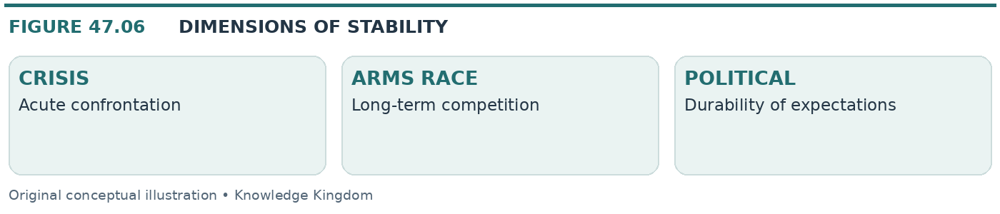

Стратегическата стабилност е широко понятие за условия, при които военната конкуренция с голяма сила е по-малко вероятно да доведе до катастрофални конфликти. Анализаторите го използват по различни начини. Кризисната стабилност се отнася до опасността острите конфронтации да станат неконтролируеми. Стабилността на оръжията се отнася до тенденцията за военна конкуренция да генерира постоянен натиск за разширяване. Политическата стабилност включва трайността на договореностите, комуникацията и очакванията с течение на времето. Тези измерения могат да се припокриват без да се движат заедно.

Да разгледаме хипотетични международни отношения, в които две правителства са се съгласили да не променят съществуващата граница и са създали надежден механизъм за обсъждане на инциденти. Дипломатическите им отношения могат да станат по-предсказуеми, докато конкуренцията им в областта на технологиите се засилва. Коментатор, който говори за "стабилност," трябва да идентифицира обсъжданото измерение. По същия начин споразумението за контрол на оръжията може да подобри прозрачността, без да разрешава териториалния конфликт, който направи двете правителства подозрителни.

Обща грешка е да се разглежда стабилността като свойство само на числен баланс. Институции, съюзи, вътрешна политика, възприятия за легитимност и дипломатически контакт всички въпроси. Дори описанието на стабилността може да се оспори: статукво, което големите сили намират за удобно, може да бъде неприемливо за гражданите на по-малка държава, чиято независимост е компрометирана. Не трябва да използваме липсата на конфронтация с голяма сила като морално одобрение на всяко заобикалящо го политическо споразумение. Подходящият въпрос е кои рискове се намаляват, с какви институционални средства и за кого. \[<a href="/047-deterrence-and-nuclear-strategy/sources/#source-12" class="cite">12</a>\]\[<a href="/047-deterrence-and-nuclear-strategy/sources/#source-15" class="cite">15</a>\]\[<a href="/047-deterrence-and-nuclear-strategy/sources/#source-16" class="cite">16</a>\]

<figure class="figure" id="figure-47-6">

<figcaption>Фигура 47.6. Стабилността има няколко измерения. <a class="figure-anchor" href="#figure-47-6" aria-label="Link to this figure">#</a></figcaption>
</figure>
