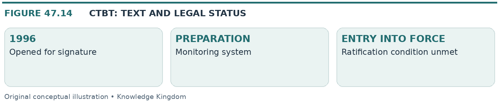

Всеобхватният Договор за ядрените опити, открит за подписване през 1996 г., забранява експлозии с ядрени оръжия и други ядрени експлозии. Неговият обхват е по-широк от този на договора от 1963 г. Въпреки това влизането му в сила е предмет на специално изискване: ратификацията от държавите, посочени в приложение 2, следвана от предписания срок на изчакване. От датата на редакционното проучване през ноември 2026 г. договорът не е влязъл в сила. Това разграничение между договорен текст и правно ефективен договор е от основно значение за международното право.

Подготвителната комисия за Всеобхватната Договорна организация за ядрени опити и експерименти разработи международна система за проверка в очакване на влизането в сила. Нейните дейности по мониторинг и анализ подкрепят осъзнаването на съответните събития. Някои формални договорни правомощия, като например механизма за проверка на място, зависят от влизането в сила. Следователно е неточно или да се опише договорът като напълно функциониращ във всяко правно отношение, или да се отхвърли съществуващата институция като безсмислена, тъй като Договорът не е влязъл в сила.

ДПЗЯО демонстрира, че международното сътрудничество може да доведе до частични практически ползи, преди всички правни условия да бъдат изпълнени. То също така показва как институционалният дизайн на споразумението може да се превърне в пречка за пълната му ефективност. Едно изискващо правило за влизане в сила може да е било предназначено да гарантира участието на особено важни държави, но също така означава, че малък брой неуредени ратифицирания могат да забавят договора безкрайно. Това е полезен пример за напрежението между приобщаващото участие и институционалната гъвкавост, която се появява в международната политика. \[<a href="/047-deterrence-and-nuclear-strategy/sources/#source-45" class="cite">45</a>\]\[<a href="/047-deterrence-and-nuclear-strategy/sources/#source-46" class="cite">46</a>\]\[<a href="/047-deterrence-and-nuclear-strategy/sources/#source-47" class="cite">47</a>\]

<figure class="figure" id="figure-47-14">

<figcaption>Фигура 47.14. Статус от ноември 2026 г. <a class="figure-anchor" href="#figure-47-14" aria-label="Link to this figure">#</a></figcaption>
</figure>
