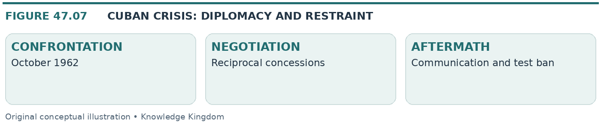

През октомври 1962 г. конфронтация, засягаща Съединените щати, Съветския съюз и Куба, доведе до острата опасност от ядрена война. Кризата възникна от комбинация от съперничество в Студената война, съветски действия в Куба, американски опасения за сигурността и опита на острова на враждебност от Съединените щати. Куба беше независим политически актьор, а не просто площад на суперсила шахматна дъска. Нейното правителство има свои собствени причини да се страхува от намеса, особено след проваленото нахлуване в Залива на прасетата през 1961 г.

Кризата беше решена чрез дипломатически обмен и отстъпки. Съветският съюз се съгласи да премахне въпросните оръжия от Куба; Съединените щати публично се ангажираха да не нахлуват на острова и лично се съгласиха да премахнат американските ракети от Тюркие. Общественото и личното измерение на споразумението илюстрират, че дипломатическият резултат може да бъде разбран по различен начин от местните зрители и от страните, които са го договорили. Един опростен разказ, в който единият лидер показа решителност, а другият просто се предаде, замъглява компромисите, които помогнаха да се сложи край на кризата.

Опитът е допринесъл за по-сериозен преглед на комуникацията и контрола върху оръжията, включително създаването на пряка комуникационна връзка между Вашингтон и Москва през 1963 г. и Договора за ограничена забрана на тестването от същата година. Не може да се предположи от мирния резултат, че предходната опасност е била необходима или желана. Знаем, че страните са постигнали споразумение; не знаем, че всеки алтернативен курс би предизвикал война. Епизодът показва както потенциалното значение на сдържаността, така и границите на увереното ретроспективно разказване на истории. \[<a href="/047-deterrence-and-nuclear-strategy/sources/#source-22" class="cite">22</a>\]\[<a href="/047-deterrence-and-nuclear-strategy/sources/#source-23" class="cite">23</a>\]

<figure class="figure" id="figure-47-7">

<figcaption>Фигура 47.7. Избрани политически постижения, а не оперативна сметка. <a class="figure-anchor" href="#figure-47-7" aria-label="Link to this figure">#</a></figcaption>
</figure>
