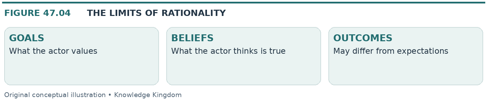

Един рационален актьор, в скромния смисъл на думата, използван от много социални учени, прави избори, които са съвместими с неговите цели и вярвания. Това не означава, че актьорът знае всичко, притежава точни вярвания, има възхитителни цели или изчислява без грешка. Човек, който поема по грешен път, защото доверената карта съдържа грешка, може да е действал разумно върху фалшива информация. Международните лидери срещат подобни проблеми в далеч по-голям мащаб.

Теорията на Deterrence често опростява решенията на правителството, като третира държавите като актьори. Това е легитимно аналитично удобство, когато въпросът засяга международните стимули. Става подвеждащо, ако забравим, че една държава включва конкурентни длъжностни лица, бюрократи, разузнавателни организации, военни институции и политически лидери. Те може да не са съгласни с това, което информацията е надеждна и това, което интересите на страната изискват. Никоя човешка институция не вижда международната система като цялостна и прозрачна картина.

Теориите за възпиране са най-силни, когато техните предположения са направени ясно. Рационалността, достатъчно споделените интерпретации на последствията, организационния контрол и политическата приемственост са различни предположения. Една страна може да цени оцеляването и въпреки това погрешно да тълкува намеренията на съперника. Тя може да разбере опасността, но притежава слабо координирани институции. Тя може да има точна оценка при една криза и неточна оценка в следващата. Въпросът не е дали лидерите винаги са рационални или винаги ирационални, а кои условия правят разумното решение по-вероятно. Това е пряко прилагане на уроците от глави 1 и 7: моделите осветяват системите, когато си спомняме процесите, които пропускат. \[<a href="/047-deterrence-and-nuclear-strategy/sources/#source-12" class="cite">12</a>\]\[<a href="/047-deterrence-and-nuclear-strategy/sources/#source-14" class="cite">14</a>\]

<figure class="figure" id="figure-47-4">

<figcaption>Фигура 47.4. Рационалният избор не означава съвършено познание. <a class="figure-anchor" href="#figure-47-4" aria-label="Link to this figure">#</a></figcaption>
</figure>
