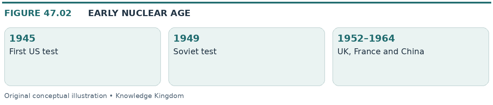

Съединените щати бяха единствената държава, притежаваща ядрени оръжия в края на Втората световна война. За кратък период от време някои наблюдатели се надявали, че този монопол ще осигури постоянно стратегическо превъзходство или ще позволи международен надзор върху атомния ред. Първият ядрен тест на Съветския съюз през 1949 г. сложи край на монопола. Великобритания следвана през 1952 г., Франция през 1960 г. и Китай през 1964 г. Тези дати бележат промени в разпределението на властта, нито един единен път, по който държавите са дошли да вземат решения.

Развитието на тези арсенали е свързано с националния престиж, политиката на съюза, опита от войната и възприемането на уязвимостта. Британските и френските решения, например, не могат да бъдат разбрани просто като отговори на броя на оръжията, които е притежавала друга държава. Правителствата също се притесняваха за независимостта във външната политика, позицията им сред големите сили и надеждността на съюзниците. Китай се сблъскал с различна историческа обстановка, оформена от революция, външна намеса, Корейската война и влошаващи се отношения със Съветския съюз. Сигурността взаимодейства с политическата идентичност.

В същото време имаше ранни усилия за контролиране на новата опасност в международен план. Първата резолюция на Общото събрание на Организацията на обединените нации през януари 1946 г. създаде комисия за справяне с атомната енергия. Следователно идеята за международно регулиране предхожда по-късната суперсила система за контрол на оръжията. Нейните трудности не били просто научни. Правителствата не са съгласни с разпределението на правомощията, надеждността на проверките и връзката между съществуващите арсенали и бъдещите задължения. Проблемът на доверието, с който се сблъскахме в глава 45, сега е неделим от технология, която може да има глобални последици. \[<a href="/047-deterrence-and-nuclear-strategy/sources/#source-6" class="cite">6</a>\]\[<a href="/047-deterrence-and-nuclear-strategy/sources/#source-8" class="cite">8</a>\]\[<a href="/047-deterrence-and-nuclear-strategy/sources/#source-9" class="cite">9</a>\]

<figure class="figure" id="figure-47-2">

<figcaption>Фигура 47.2. Избрани исторически постижения в ранната ядрена епоха. <a class="figure-anchor" href="#figure-47-2" aria-label="Link to this figure">#</a></figcaption>
</figure>
