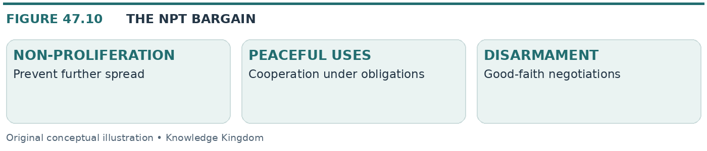

Договорът за неразпространение на ядрени оръжия бе открит за подписване през 1968 г. и влезе в сила през 1970 г. През 1995 г. нейните страни се съгласиха да го разширят за неопределено време. Договорът често се описва чрез три свързани стълба: предотвратяване на разпространението на ядрени оръжия, сътрудничество в мирно използване на ядрената енергия и ядрено разоръжаване. И тримата са необходими, за да разберат сделката. Представянето на договора като забрана само за придобиване дава непълна представа за задълженията, приети от неговите членове.

Договорът отличава държавите с ядрено оръжие, както е определено от неговия исторически критерий, от страните, които не са членки на ядрени оръжия. Петте признати държави с ядрено оръжие съгласно това определение са Съединените щати, Русия като приемник на Съветския съюз, Обединеното кралство, Франция и Китай. Тази категория е статут на договор, а не подробен списък на всяка страна с ядрени оръжия. Индия, Пакистан и Израел никога не се присъединиха към ДНЯО; Северна Корея обяви оттеглянето си през 2003 г. Признаването на съществуващото разграничение в договора не представлява вечно морално право на притежание.

Член VI изисква от страните да водят преговори за добронамереност относно ефективни мерки във връзка с прекратяването на ядрената надпревара и ядреното разоръжаване, наред с по-широките цели за разоръжаване. За много неядрени държави този ангажимент е от основно значение за справедливостта и легитимността на режима. За ядрените въоръжени партии отношенията между задълженията за разоръжаване и международните условия за сигурност остават основен политически дебат. Следователно ДНЯО е както правен инструмент, така и политическа сделка, чиято трайност зависи отчасти от това как неговите членове разбират изпълнението на задълженията на другите. \[<a href="/047-deterrence-and-nuclear-strategy/sources/#source-9" class="cite">9</a>\]\[<a href="/047-deterrence-and-nuclear-strategy/sources/#source-31" class="cite">31</a>\]\[<a href="/047-deterrence-and-nuclear-strategy/sources/#source-32" class="cite">32</a>\]

<figure class="figure" id="figure-47-10">

<figcaption>Фигура 47.10. Трите стълба са свързани. <a class="figure-anchor" href="#figure-47-10" aria-label="Link to this figure">#</a></figcaption>
</figure>
