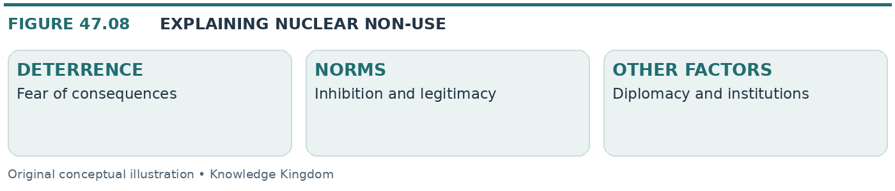

След бомбардировките на Хирошима и Нагасаки през 1945 г. ядрените оръжия не са били използвани във война. Основен въпрос за стипендията за международни отношения е защо. Deterrence предлага един отговор: лидерите се страхуват от последиците от употреба, включително отмъщение или ескалация. Но някои войни са включвали ядрени държави и противници без свои собствени ядрени оръжия. Защо правителствата понякога се въздържали дори при такива обстоятелства?

Нина Таненвалд твърди, че през годините след 1945 г. се е развила нормативна забрана за ядрено използване. Нормите са споделени очаквания за подходящо поведение, а не непременно формални правни правила. Правителството може да счита действията за неприемливи отчасти поради политическото и морално значение, свързано с него, независимо от преките военни последици. Растежът на антиядрените движения, дипломатическото осъждане и обществената осведоменост за хуманитарната вреда помогнаха да се оформи политическата среда, в която бяха взети решения.

Не всички учени приемат една и съща сила или обхват за ядреното табу. Някои отличават традицията да не се използва от дълбока морална забрана. Проучванията показват също, че публичното противопоставяне може силно да зависи от обстоятелствата. Доказателствата не оправдават предположението, че норма винаги ще оцелее при натиск. Нормалността може да бъде влиятелна, без да е абсолютна. Детеренцията и нормите също могат да действат заедно: решение може да отразява страха от военни последици, правни притеснения, очаквания за международно осъждане и лична морална преценка едновременно. Едно сериозно обяснение трябва да отчита взаимодействието на тези фактори, вместо да принуждава историята да избере една единствена причина. \[<a href="/047-deterrence-and-nuclear-strategy/sources/#source-26" class="cite">26</a>\]\[<a href="/047-deterrence-and-nuclear-strategy/sources/#source-27" class="cite">27</a>\]\[<a href="/047-deterrence-and-nuclear-strategy/sources/#source-28" class="cite">28</a>\]

<figure class="figure" id="figure-47-8">

<figcaption>Фигура 47.8. Няколко обяснения могат да работят заедно. <a class="figure-anchor" href="#figure-47-8" aria-label="Link to this figure">#</a></figcaption>
</figure>
