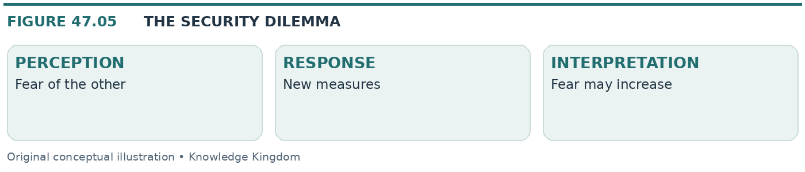

В глава 45 разгледахме дилемата за сигурността: действията, насочени към повишаване на сигурността на една държава, могат да намалят чувството за сигурност на друга страна. Ядрената политика засилва тази трудност. Правителството може да опише една скъпа военна програма като необходима за националната защита, докато съперникът я разглежда като доказателство за враждебни намерения. Второто правителство реагира, първото се чувства оправдано и взаимното подозрение се задълбочава. Всяка страна може да разкаже убедителна история, в която тя просто е реагирала на другата.

Моделът не означава, че всеки международен спор е невинно недоразумение. Някои държави съзнателно търсят териториално завоевание или се опитват да сплашат другите; агресията не е изтрита от речника на несигурността. Дилемата на сигурността е полезна, защото идентифицира един механизъм, чрез който страхът може да се самонасили, включително във взаимоотношенията, в които лидерите имат смесени мотиви. Един внимателен анализ трябва да разгледа доказателствата за различни тълкувания, вместо да приеме, че всички страни имат еднаква отговорност.

Разграничаването между намерение и наблюдаема способност е централно. Лидерите на една страна могат да обявят доброкачествени цели, но други не могат просто да спазват частни намерения или да гарантират, че бъдещите правителства ще ги споделят. В същото време, ако приемем най-лошото във всеки случай може да направи настаняване невъзможно. Дипломацията, прозрачността и споразуменията могат да намалят несигурността, без да изискват приятелство. Свят, в който противниците разбират задълженията си и общуват надеждно, не е същият като един свят без конфликти; той е свят, в който някои избегнати форми на конфликт стават по-малко вероятни. \[<a href="/047-deterrence-and-nuclear-strategy/sources/#source-12" class="cite">12</a>\]\[<a href="/047-deterrence-and-nuclear-strategy/sources/#source-15" class="cite">15</a>\]

<figure class="figure" id="figure-47-5">

<figcaption>Фигура 47.5. Процесът на самонасилване; действителната агресия изисква отделна оценка. <a class="figure-anchor" href="#figure-47-5" aria-label="Link to this figure">#</a></figcaption>
</figure>
