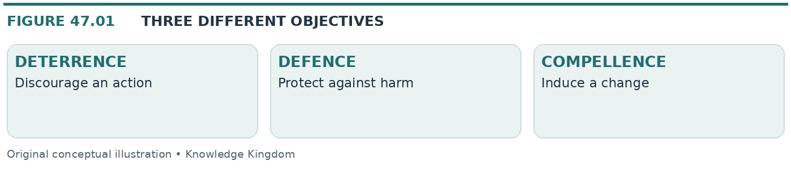

Deterrence е опит да убеди друг актьор да не предприема действия, като променя очакванията си за последствията. Продавачът може да инсталира охранителна система с надеждата, че кражбата няма да се случи. Правителството може да наложи санкции, за да обезкуражи нарушаване на споразумение. Договорът за колективна отбрана може да обезкуражи атака, като накара бъдещия агресор да очаква противопоставяне от повече от една страна. Основната идея е поведение, а не механично: мярка възпира само ако влияе на избора на друг актьор.

Полезно е да се разграничи възпирането от защитата. Защитата се стреми да защити хората или територията, когато настъпи вреда; възпирането цели да предотврати на първо място вредно решение. Една-единствена институция може да допринесе и за двете, но концепциите не могат да се третират като синоними. Нито се възпира от дипломацията. Дипломацията е по-широка практика на общуване и преговори между политическите общности и може да включва увереност, заплахи, обещания и компромиси. Детеренцията може да действа в рамките на тази практика, вместо да я замени.

Работата на Томас Шелинг поставя пазарлък и очаквания в центъра на изучаването на конфликта. Значението на неговата стипендия не е, че всеки човек изчислява перфектно. Международната политика включва решения, взети в очакване на други решения. Политика, чиято цел е получателят да я тълкува по различен начин от изпращача, може да има ефект срещу желания. Поради тази причина е полезно да се запитаме какво решение се предполага, че е предотвратено, кой го е направил и какви доказателства съществуват за променено очакване. Неясната декларация, че една страна е "оттеглена," не е цялостно обяснение. \[<a href="/047-deterrence-and-nuclear-strategy/sources/#source-3" class="cite">3</a>\]

<figure class="figure" id="figure-47-1">

<figcaption>Фигура 47.1. Тези концепции определят различни цели, а не йерархия на политиките. <a class="figure-anchor" href="#figure-47-1" aria-label="Link to this figure">#</a></figcaption>
</figure>
