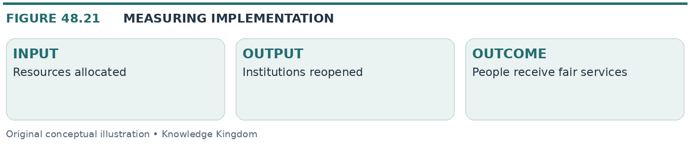

В Лидора политическото споразумение обещава възстановяването на местните съдилища, равния достъп до училищата, защитата на разселените семейства и независимия обществен бюджет. Две години по-късно правителствени служители посочват нови сгради и твърдят, че споразумението е успяло. Според организациите на гражданското общество много от жителите остават неспособни да използват институциите. Как наблюдателят трябва да оцени тези очевидно конкурентни твърдения?

Започнете чрез разграничаване на входове, изходи и резултати. Средствата, разпределени на съда, са принос. Наемането на чиновници и възобновяването на съда са изходи. Жителите, които получават навременни, справедливи и изпълними решения, са резултат. Институцията може да постигне целта си за производство, като същевременно не е изпълнила предвидената обществена полза. Същото разграничение се отнася и за училище, здравна клиника или офис за регистрация на недвижими имоти. Сградите имат значение, но обществената цел не е самите сгради.

Комисията може да разгледа независими проучвания, записи от услуги, процедури за подаване на жалби, публични разходи и опита на различни общности. Тя следва да докладва за несигурност и да позволява доказателства от жители, които не могат да бъдат представени в официалните регистри. Когато статистиката и личните показания изглеждат непоследователни, тя следва да разследва причините, а не автоматично да отхвърля една форма на доказателства. Едно проучване може да прикрие регионалното неравенство; индивидуалният доклад може да идентифицира важен провал, без да установи разпространението му. Целта на проверката е да се направят политически обещания, отговарящи на наблюдаваните публични резултати.

<figure class="figure" id="figure-48-21">

<figcaption>Фигура 48.21. Изходите са от значение, но резултатите проверяват дали политиката служи на гражданите. <a class="figure-anchor" href="#figure-48-21" aria-label="Link to this figure">#</a></figcaption>
</figure>
