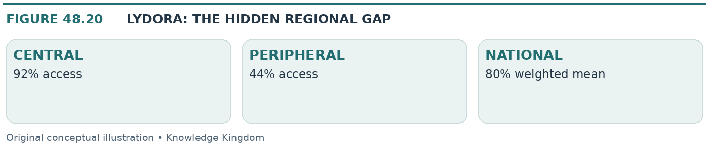

Върнете се в измисления щат Лидора. Едно проучване съобщава, че 80% от домакинствата в страната имат достъп до функциониращо основно здравно заведение. Това звучи успокояващо, докато не открием, че 75 процента от домакинствата живеят в централната част на региона, където достъпът е 92%, а останалата четвърт живее в периферен регион, където достъпът е само 44 процента.

Провери аритметиката. В хипотетично население от 1000 домакинства 750 живеят в центъра. 92 процента от 750 е 690. От 250-те периферни домакинства, 44 процента или 110 имат достъп. Заедно 800 домакинства имат достъп, което дава обявената национална ставка от 80 процента. Средното е математически правилно. Въпреки това той крие 48-процентова разлика между двата региона.

Статистиката не определя защо съществува празнината. Може би периферният регион е планински, има по-малко пътища или е претърпял скорошни инфраструктурни щети. Може би държавното финансиране е било разпределяно несправедливо. Няколко механизма могат да работят заедно. Едно внимателно разследване ще разгледа разходите, времето за пътуване, персонала, здравните резултати, историческите инвестиции и опита на домакинствата. Тя също би попитала дали гражданите могат да влияят на решенията и да получат средства за защита. Численото несъответствие е отправна точка за анализ, а не доказателство за дискриминационни намерения или предвиждане на гражданска война.

<figure class="figure" id="figure-48-20">

<figcaption>Фигура 48.20. Измислени данни: регионалното разминаване е 48 процентни пункта. <a class="figure-anchor" href="#figure-48-20" aria-label="Link to this figure">#</a></figcaption>
</figure>
