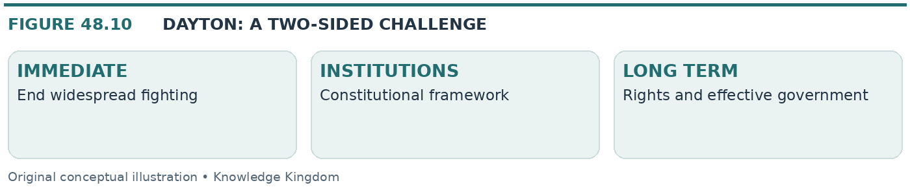

Разпадането на социалистическа Югославия включваше конкурентни претенции за суверенитет, национализъм, политическа власт и територия. Войната в Босна и Херцеговина от 1992 г. (1995 г.) включваше систематично принудително изсичане, преследване и други зверства. Впоследствие международни съдилища установиха, че геноцидът е извършен в Сребреница през юли 1995 г. Това е съдебна находка, а не само една политическа интерпретация на конфликта. \[<a href="/048-civil-wars-and-fragile-states/sources/#source-28" class="cite">28</a>\]

Дейтънското споразумение, договорено през ноември и подписано през декември 1995 г., сложи край на войната и осигури конституционна рамка за Босна и Херцеговина, включително две автономни области и институции на държавно ниво. Заселването помогна да се сложи край на широко разпространените военни действия, но неговите договорености също институционализираха определени политически различия между съставните народи. По-късните спорове засягат ефективността и приобщаването на тези институции. \[<a href="/048-civil-wars-and-fragile-states/sources/#source-29" class="cite">29</a>\]

Това показва трудна дилема за изграждане на мир. Конституционното споразумение, приемливо за противоположни лидери в края на войната, може да намали непосредствените страхове и същевременно да усложни дългосрочната политическа интеграция. Подходящото сравнение не е между действително несъвършено споразумение и въображаем идеал без политически ограничения. Това е между реалистични алтернативи, рисковете, които съществуват при договарянето на споразумението и възможностите за по-късна реформа. Краят на войната е съществено постижение, но това не пречи на гражданите да изискват по-равноправни и ефективни институции през следващите десетилетия.

<figure class="figure" id="figure-48-10">

<figcaption>Фигура 48.10. Краят на борбата и институционалната трансформация са отделни постижения. <a class="figure-anchor" href="#figure-48-10" aria-label="Link to this figure">#</a></figcaption>
</figure>
