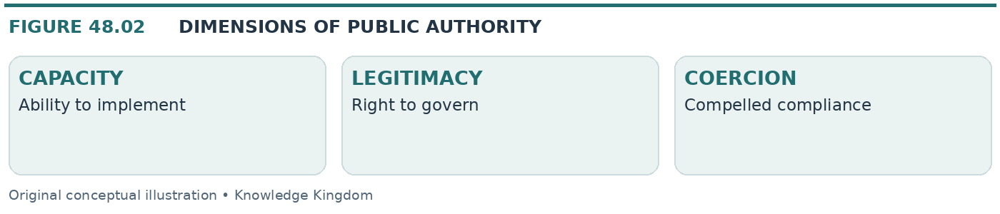

Държавният капацитет е способността на институциите да изпълняват публични решения. Тя може да включва събиране на приходи, предоставяне на услуги, администриране на правосъдието и прилагане на закона. Легитимността е възприятие или нормативно твърдение, че дадена власт има право да управлява. Принуда е способността да се налага спазване чрез сила или заплахи. Тези три качества си взаимодействат, но не е задължително да се издигат заедно.

Правителството може ефективно да събира данъци, като изключва малцинство от политическо участие. Нейният административен капацитет може да бъде значителен, дори когато много жители оспорват легитимността му. Друго правителство може да се радва на широка популярна подкрепа след независимост, но не разполага с необходимите ресурси и обучени длъжностни лица за предоставяне на основни услуги. Една трета може да доминира противниците чрез репресии, като същевременно не успява да поддържа надеждна съдебна система. Питайки дали всяко правителство е "силно" крие тези важни различия.

Легиалността също не е нито едно национално мнение. На общинската администрация може да се има доверие, защото нейните служители познават жителите и предоставят услуги надеждно, докато националният кабинет е широко недоверие. Гражданите могат да считат конституцията за законна, но въпреки това се противопоставят на правителството, което понастоящем действа под нея. Едно проучване, проведено само в столицата, може да не разкрие как други области изпитват авторитет. Ето защо добрият анализ изисква: способност да се направи какво, легитимност в чии очи и власт над коя територия? \[<a href="/048-civil-wars-and-fragile-states/sources/#source-6" class="cite">6</a>\]\[<a href="/048-civil-wars-and-fragile-states/sources/#source-7" class="cite">7</a>\]

<figure class="figure" id="figure-48-2">

<figcaption>Фигура 48.2. Капацитетът, легитимността и принуда могат да варират независимо. <a class="figure-anchor" href="#figure-48-2" aria-label="Link to this figure">#</a></figcaption>
</figure>
