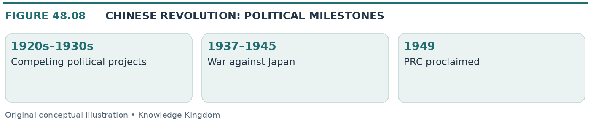

Китайската гражданска война между националистите (Куоминтанг) и комунистите се развива през няколко фази от края на 20-те до 1949 г., прекъсвани от периоди на сътрудничество срещу японската инвазия. Срутването на императорските институции, борбата срещу политическата власт, неравенството в селските райони, чуждестранната намеса и опустошението на войната между сино-японските граждани формираха част от нейния контекст. \[<a href="/048-civil-wars-and-fragile-states/sources/#source-21" class="cite">21</a>\]

През 1949 г. Китайската народна република е обявена на континента, докато правителството на Република Китай се премества в Тайван. В резултат на това политическото разделение остава основен международен въпрос. Историческото разграничение между края на основната фаза на гражданската война на континента и решаването на конкурентни политически претенции е от съществено значение. Един военен и политически изход не трябва да разрешава всички спорове за суверенитет или признаване.

Случаят е и напомняне, че чуждестранната инвазия и вътрешният политически конфликт могат да се припокриват. Хронология, описваща само две местни партии, би замъглила значението на японската имперска експанзия и последиците от нея. Хронология, свързана само с чуждестранна инвазия, би пренебрегнала конкурентните китайски политически проекти. Историческата причинно-следствена връзка често работи на няколко нива и внимателен акаунт отличава всеки, без да се преструва, че един фактор отменя другите.

<figure class="figure" id="figure-48-8">

<figcaption>Фигура 48.8. Избрани исторически постижения, а не военна хронология. <a class="figure-anchor" href="#figure-48-8" aria-label="Link to this figure">#</a></figcaption>
</figure>
