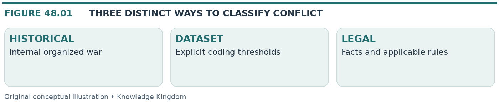

Гражданската война обикновено означава постоянен организиран въоръжен конфликт в рамките на политическа общност, който включва държавни и организирани претенденти. Участниците могат да търсят контрол върху управлението, автономията за регион, отцепване или фундаментална промяна в политическия ред. Конфликтът с правителството и конфликтът с територията могат да се припокриват. Някои войни включват няколко организации, чиито цели се променят по време на конфликта. прилагателното "гражданско" не означава цивилизовано, нито пък означава, че външни лица отсъстват.

Терминът се използва по различен начин от историци, адвокати и изследователи на данни. Програмата за данни относно конфликтите в Упсала (UCDP) има специфична категория въоръжени конфликти: спор за правителство или територия, включващ най-малко едно държавно правителство и достигащ 25 смъртни случая, свързани с бойни действия, през календарната година. Неговата категория на война използва праг от 1000 такива смъртни случаи за една година. Тези прагове са изследователски конвенции, а не универсални определения за гражданска война и не правни тестове за това дали жертвите заслужават защита. \[<a href="/048-civil-wars-and-fragile-states/sources/#source-1" class="cite">1</a>\]\[<a href="/048-civil-wars-and-fragile-states/sources/#source-2" class="cite">2</a>\]

Да разгледаме два измислени конфликта, които продължават три години. Едната отговаря на годишния праг всяка година, а другата - само през втората година. Наборът от данни може да брои различни брой на активните конфликти-години, дори ако и двете общества изпитват продължителен страх и смущения. Ако един изследовател брои войните, а друг брои години конфликти, графиките им могат да се различават, без да грешат. Преди да обсъдим една тенденция, провери какво всъщност представлява единицата.

Изследователите също така отличават началото на конфликт, неговата продължителност, неговото прекратяване и неговото повторение. Това са четири свързани, но различни въпроси. Фактор, свързан с началото на конфликта, може да не обясни защо продължава. Политическото споразумение може да сложи край на определен конфликт, докато друга форма на насилие продължава. Дори един внимателно изграден годишен набор от данни не може да ни каже дали отделните семейства смятат периода за мирен. Анализаторът трябва да устои на изкушението да трансформира всяка статистическа граница в историческа повратна точка. \[<a href="/048-civil-wars-and-fragile-states/sources/#source-2" class="cite">2</a>\]\[<a href="/048-civil-wars-and-fragile-states/sources/#source-52" class="cite">52</a>\]

<figure class="figure" id="figure-48-1">

<figcaption>Фигура 48.1. Историческите, статистическите и правните категории служат за различни цели. <a class="figure-anchor" href="#figure-48-1" aria-label="Link to this figure">#</a></figcaption>
</figure>
