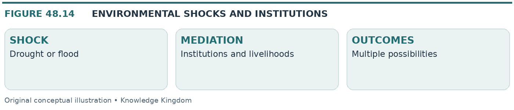

Влаченето, наводненията, нарастващите температури и влошаването на околната среда могат да застрашат селскостопанските поминъки, да увеличат продоволствената несигурност и да обтегнат обществените услуги. Въпреки това е подвеждащо да се каже, че изменението на климата механично води гражданска война. Подобни екологични шокове могат да имат много различни последици в зависимост от институциите, икономическите алтернативи, инфраструктурата, застраховката, управлението на земята и достъпа до политически средства за защита.

В шестия доклад за оценка на МПК се описват връзките между изменението на климата и свързаните с конфликти рискове, включително пътищата чрез поминъка и продоволствената несигурност. Той също така отличава по-силните доказателства за някои форми на нискоинтензитетно организирано насилие от доказателствата за голям въоръжен конфликт. \[<a href="/048-civil-wars-and-fragile-states/sources/#source-41" class="cite">41</a>\] Важното е да изследваме механизмите и несигурността, вместо да използваме климата като универсално обяснение за насилието. Сушата може да направи политическия спор по-труден за управление; тя не определя избора на правителства или въоръжени групи.

Да предположим, че два измислени земеделски региона имат същото намаление на валежите. Единият има надеждно напояване, независима институция за разрешаване на спорове и подпомагане на доходите по време на лоша реколта. Другият има неравнопоставен достъп до вода, произволни решения за земята и малко социална защита. Екологичният шок се споделя, но социалните последици са различни. Ето защо един полезен отговор на политиката ще разгледа както адаптирането към климата, така и и институционалната справедливост. Политика, насочена към валежите, пренебрегвайки дискриминацията, би пренебрегнала голяма част от проблема, точно както една политика, насочена към политическото представителство, докато пренебрегването на недостига на вода може да остави значителна уязвимост недокосната.

<figure class="figure" id="figure-48-14">

<figcaption>Фигура 48.14. Натискът върху околната среда не определя политическите резултати \[41\]. <a class="figure-anchor" href="#figure-48-14" aria-label="Link to this figure">#</a></figcaption>
</figure>
