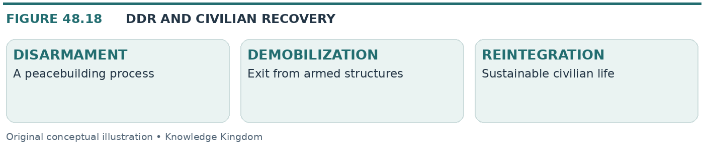

Акронимът DDR се отнася до разоръжаването, демобилизацията и реинтеграцията. В изграждането на мира това са свързани процеси, чрез които бивши членове на въоръжени организации напускат тези структури и навлизат в гражданския живот, в рамките на приложимите споразумения и правни рамки. \[<a href="/048-civil-wars-and-fragile-states/sources/#source-46" class="cite">46</a>\] Социалните и институционални предизвикателства се простират далеч отвъд официалното завършване на всяка конкретна програма.

Човек може да напусне въоръжена организация, но все още няма препитание, образование, жилищно настаняване или гражданска документация. Получаващата общност може да е претърпяла сериозна вреда и може да се възмути от помощта, възприемана като облагодетелстваща бивши участници за сметка на жертвите. Това са основателни опасения, с които институциите трябва да се справят справедливо. Следователно програмите следва да бъдат оценени не само от това колко лица са завършили административна процедура, но и дали хората могат да получат безопасен, законен и устойчив препитание, както и дали засегнатите общности имат достъп до услуги и средства за защита.

Реформата в сектора за сигурност е свързана, но различна задача. Той засяга институциите, отговорни за сигурността, техните правни мандати, професионално поведение, надзор и отчетност. Възстановяването на доверието в полицията и други публични институции изисква жителите да могат да докладват за злоупотреби без страх и да очакват да бъдат разследвани оплаквания. Нито гражданската реинтеграция, нито реформата на институциите за сигурност следва да се третират като заместител на наказателната отговорност при тежки престъпления. Устойчивото възстановяване изисква обществена безопасност, индивидуални права и справедлив достъп до възможности, които трябва да се разглеждат заедно.

<figure class="figure" id="figure-48-18">

<figcaption>Фигура 48.18. DDR не заменя наказателната отчетност или възстановяването на общността. <a class="figure-anchor" href="#figure-48-18" aria-label="Link to this figure">#</a></figcaption>
</figure>
