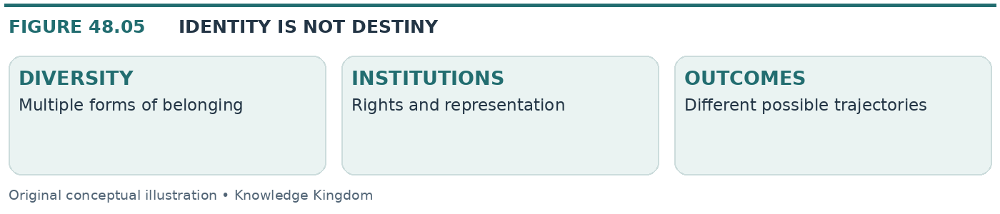

Етническата идентичност може да включва общ език, семейни традиции, колективни спомени или вяра в общото наследство. Тя не определя автоматично политическата вярност. Човек може едновременно да се идентифицира с религиозна общност, регион, професия и нация. Всяка форма на принадлежност може да стане повече или по-малко политически чувствителна в зависимост от обстоятелствата.

Ларс-Ерик Седерман, Андреас Уимър и Браян Мин разследваха връзката между етническата политика и конфликта, подчертавайки ролята на достъпа до централната държавна власт, вместо да третират етническата принадлежност като чисто демографска променлива. \[<a href="/048-civil-wars-and-fragile-states/sources/#source-13" class="cite">13</a>\]\[<a href="/048-civil-wars-and-fragile-states/sources/#source-14" class="cite">14</a>\] Важното разграничение е между съществуването на различни идентичности и институции, които разпространяват права и възможности неравномерно помежду си. Етническото разнообразие не е само по себе си морален проблем или достатъчно предричащ война.

Да разгледаме две хипотетични състояния с идентични размери на населението. Първо, гражданството, обществената заетост и достъпът до правосъдие са независими от етнически произход. В другата доминираща партия систематично отрича политическото представителство на малцинството. Същото разнообразие статистики маскира много различни социални отношения. Дори във втората страна насилието не е неизбежно: гражданска организация, политически отстъпки, правна защита и други форми на колективно действие могат да доведат до мирна промяна. Важното е как идентичностите се свързват с реални институции и политически избори.

<figure class="figure" id="figure-48-5">

<figcaption>Фигура 48.5. Политическите договорености са по-важни от категориите идентичност. <a class="figure-anchor" href="#figure-48-5" aria-label="Link to this figure">#</a></figcaption>
</figure>
