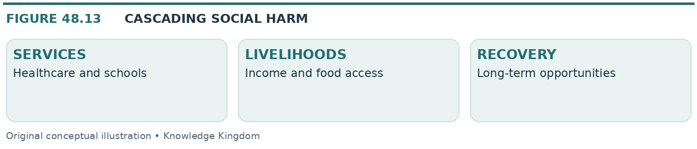

Конфликтът може да подкопае способността на обществото да поддържа живота си, дори когато отделните общности не се борят пряко. Земеделските стопани могат да загубят достъп до земя, пазарите на доставки могат да спрат да функционират, държавните здравни институции може да нямат обучен персонал и училищата могат да затворят. Разпадането на хигиената може да увеличи честотата на заболяването. Тези последствия са свързани: недохранването прави заболяването по - трудно да издържа, болестта намалява доходите на домакинствата и загубата на доходи може да задълбочи продоволствената несигурност.

Хуманитарните последици от конфликта не се ограничават само до смъртни случаи, свързани с войната. Непреките вреди са трудни за оценка, тъй като съответното сравнение е здравето и условията на живот на населението без конфликта. Изследователите могат да изследват свръх смъртност, наблюдение на заболяванията, хранителни проучвания и демографски тенденции. Всеки метод зависи от качеството и обхвата на наличните данни. Липсата на точна оценка не следва да се бърка с липсата на вреда.

Образованието създава особено дългосрочно предизвикателство. Отварянето на училищна сграда е само една част от възстановяването на образованието: децата се нуждаят от учители, достъпен транспорт, записи, езикова подкрепа и безопасност. Учениците, които са пропуснали няколко години, може да се нуждаят от гъвкави мерки, вместо да бъдат поставяни в клас единствено според възрастта. Възстановяването на едно общество зависи и от качеството на образованието, което то осигурява. Преподаването на колективна вина или изключването на децата поради политическата идентичност на тяхното семейство подкопава гражданската цел, която образованието може да служи след конфликти.

<figure class="figure" id="figure-48-13">

<figcaption>Фигура 48.13. Последиците от конфликта продължават отвъд прякото насилие. <a class="figure-anchor" href="#figure-48-13" aria-label="Link to this figure">#</a></figcaption>
</figure>
