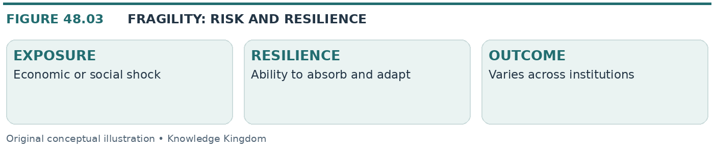

Фразата "неуспешна държава" може да предполага състояние на всичко или нищо: една страна е успяла или не е успяла. Концепцията за крехкост е по-полезна, ако се третира като спектър от излагане на опасност и способността да се издържи. В рамката на ОИСР от 2025 г. се оценяват рисковете и устойчивостта в икономическите, екологичните, човешките, политическите, сигурността и обществените измерения. Тя идентифицира 61 контекста с висока или крайна крехкост в тази рамка. Това е датирана класификация, а не вечна присъда за жителите им. \[<a href="/048-civil-wars-and-fragile-states/sources/#source-8" class="cite">8</a>\]

Крайбрежната държава може да бъде уязвима към екстремни атмосферни условия, като същевременно поддържа силни публични институции. Държавата износител на ресурси може да има значителни приходи, но да е уязвима към ценови шок. Очевидно едно процъфтяващо общество може да няма предпазни мерки срещу авторитарното насилие. Разклатеността може да се появи на нивото на град, институция или общност, дори когато средните за страната изглеждат успокояващи. Тя също може да се промени бързо след политическа криза или бавно през поколенията.

Устойчивостта е способността да абсорбираш шокове, да се адаптираш и възстановяваш. Тя може да идва от институции на правителството, но също така и от фирми, семейства, общностни асоциации и местни знания. По време на наводнение съседите, които организират временно убежище, могат да компенсират слабата публична администрация; те не могат непременно да възстановят национална електрическа мрежа. Предизвикателството е да разберем къде различните форми на устойчивост се допълват взаимно и къде ограниченията им стават опасни.

Класификацията на Световната банка за фискална 2027 година също илюстрира защо е важно да се проучи целта на измерването. Тя въведе отделни публични списъци за разпространение на организираното политическо насилие и за институционална нестабилност, вместо да съчетава тези понятия в един списък. \[<a href="/048-civil-wars-and-fragile-states/sources/#source-53" class="cite">53</a>\] Една страна може да има сериозни институционални проблеми без война и интензивността на насилието не е цялостно измерване на управлението. Агенцията може разумно да използва категории, различни от използваните от изследователя, изследващ произхода на гражданската война.

<figure class="figure" id="figure-48-3">

<figcaption>Фигура 48.3. Рамката на ОИСР оценява рисковете в шест измерения \[8\]. <a class="figure-anchor" href="#figure-48-3" aria-label="Link to this figure">#</a></figcaption>
</figure>
