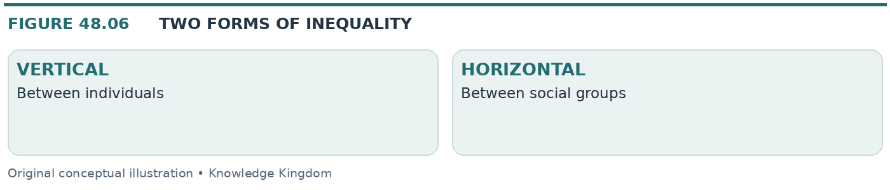

Вертикалното неравенство измерва разликите между индивидите или домакинствата. Хоризонталното неравенство се отнася до различията между социално значими групи, като региони или общности, в достъпа до икономически, политически или социални възможности. И двете могат да съществуват в една и съща държава, но националното разпределение на доходите не разкрива непременно второто. \[<a href="/048-civil-wars-and-fragile-states/sources/#source-14" class="cite">14</a>\]

Представете си две страни с еднакъв среден доход на домакинствата. В един от тях богатите и бедните домакинства се разпределят из регионите. В другия почти всички публични инвестиции отиват в един регион, а на друг липсват болници и павирани пътища. Средната стойност крие географията на недостатъка. Това не означава, че всеки човек от по-богатия регион е богат или всеки човек от по-бедния регион е беден. Средните стойности на групата никога не трябва да се превръщат в предположения за индивидите.

Важно е да се различи неравенството от дискриминацията. Измерена разлика може да отразява различна география, исторически инвестиции, неравноправна политика, демографски условия или няколко причини. Доказателствата за разминаване повдигат въпроси; доказателствата за умишлено изключване изискват повече разследване. Политиката също има множество измерения. Инфраструктурният проект може да намали пътните разходи, без да разглежда неравнопоставеното политическо представителство. Конституционната реформа може да признае равни права, като същевременно остави необезпокояваната разлика в основната услуга. Най-добрите анализи питат какво всъщност се е променило и дали хората могат да получат средства за защита, когато правата са нарушени.

<figure class="figure" id="figure-48-6">

<figcaption>Фигура 48.6. Еднаквите национални средни стойности могат да прикрият различни групови разпределения. <a class="figure-anchor" href="#figure-48-6" aria-label="Link to this figure">#</a></figcaption>
</figure>
