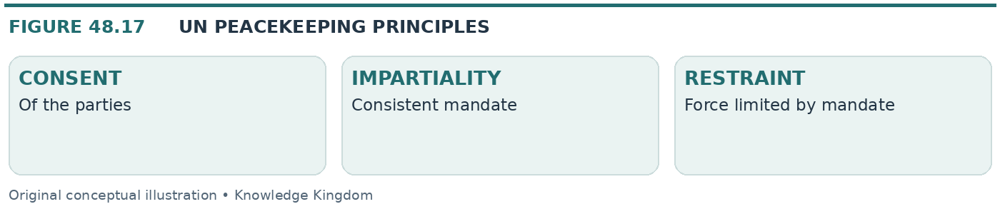

Мироопазването на Организацията на обединените нации се ръководи от три принципа: съгласие на страните, безпристрастност и ограничения за използването на сила, освен при самозащита и защита на мандата. Безпристрастието не означава да се пренебрегват нарушенията на споразумение или да се разглеждат доказателства за злоупотреби като просто конкурентни мнения. Мисиите се различават в конкретните си мандати и обстоятелства. \[<a href="/048-civil-wars-and-fragile-states/sources/#source-44" class="cite">44</a>\]

Мироопазващата операция може да подпомага гражданската защита, наблюдението, изборите, правата на човека и други задачи. Това не е световно правителство и не може сама по себе си да създаде законен национален политически ред. Способността на мисията да изпълнява работата си зависи от фактори, включително яснота на мандата, ресурси, достъп, сътрудничество и политическа подкрепа. Миропазването изисква и отчетност за поведението на собствения си персонал. Институцията, създадена за защита на цивилните граждани, подкопава нейната легитимност, когато персоналът ѝ извършва злоупотреби или не реагира адекватно на тях.

Проучване на мироопазващите опити за оценка на последиците от тях, но мисиите не се възлагат произволно. Те често биват пращани в трудни конфликти, където един неподпомаган мир може да бъде особено крехък. Затова обикновеното сравнение между страните със и без мисии може да заблуди. Изследователи като Virginia Page Fortna са разследвали дали мироопазването допринася за траен мир, като същевременно отчита характеристиките на конфликтите. \[<a href="/048-civil-wars-and-fragile-states/sources/#source-45" class="cite">45</a>\] Както и в глава 6, изборът на случаи има значение. Дори положителната средна оценка не гарантира успех във всяка настройка или премахване на необходимостта от специфична за контекста оценка.

Мандатът на конкретна мисия следва да се чете заедно с по-широката правна и политическа рамка. Хартата на Организацията на обединените нации отличава мирното уреждане съгласно глава VI от мерките по глава VII, но действителните мирни операции са се развили на практика и не могат да бъдат превърнати в единна категория харта. \[<a href="/048-civil-wars-and-fragile-states/sources/#source-61" class="cite">61</a>\] Мисията може да съчетава политическа помощ, наблюдение и защита в рамките на мандата, който ѝ е даден. Освен това публичният доклад, че дадена мисия е изпълнила определена служба, не доказва, че всяка общност се е облагодетелствала еднакво. Стандартите за поведение, приложими към мироопазващия персонал, включително забраната за сексуална експлоатация и злоупотреба, трябва да бъдат част от всяка сериозна оценка. \[<a href="/048-civil-wars-and-fragile-states/sources/#source-62" class="cite">62</a>\]

<figure class="figure" id="figure-48-17">

<figcaption>Фигура 48.17. Използването на сила е ограничено до самозащита и защита на мандата \[44\]. <a class="figure-anchor" href="#figure-48-17" aria-label="Link to this figure">#</a></figcaption>
</figure>
